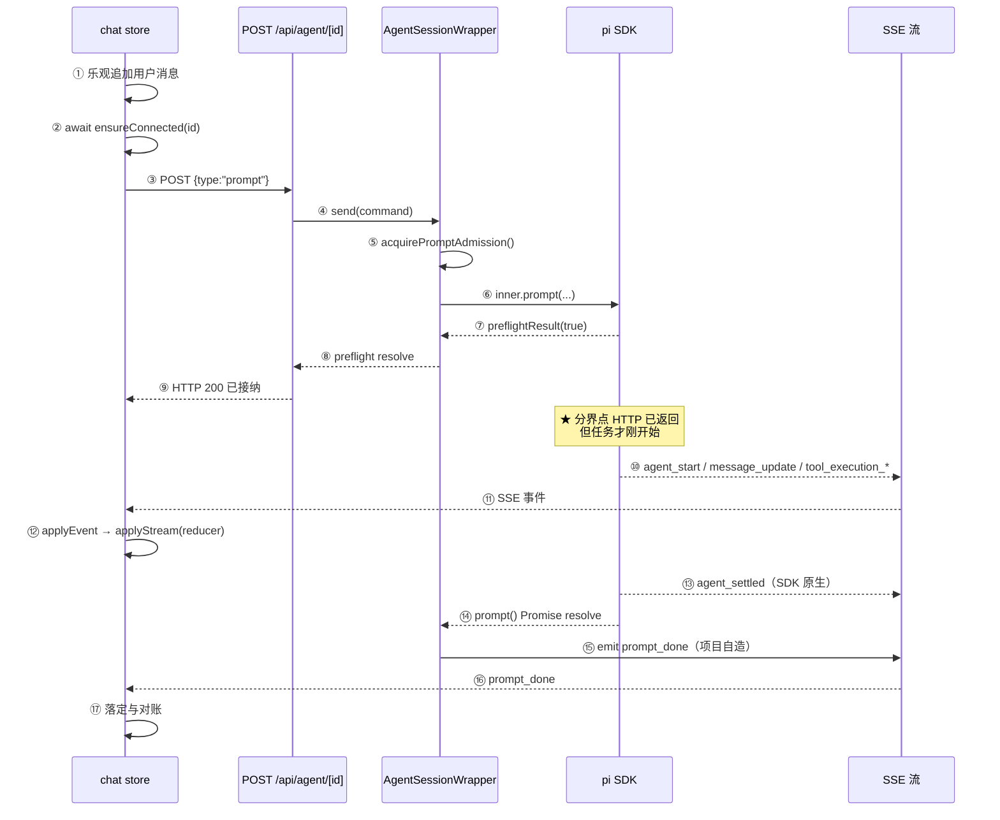

# 01 执行链路与流式传输

> 对应简历：**「在 Node 服务端集成 Pi Agent SDK，封装会话实例管理与命令分发，将模型文本、思考及工具调用等事件适配为前端事件，通过 SSE 持续推送；区分命令接纳与整轮任务完成两个时点，避免长任务阻塞请求及前端提前清理运行状态。」**
>
> 优先级：**P0** 必答，**P1** 常见追问，**P2** 加分项。
>
> 源码链接固定到 commit [`27d6bee`](https://github.com/saohuahua/pi-web-vue/tree/27d6bee5878878aedf9a296b5e5e43236b56c22e)。SDK 为 `@earendil-works/pi-coding-agent@0.85.1`。

---

## Q1 为什么给 pi 做一个 Web 界面？【P0】

**结论**：不是因为 CLI 缺能力，而是因为**终端的信息组织方式不适合长时间回看**。pi CLI 已经支持会话树导航（`/tree`）、分叉（`/fork`）、克隆（`/clone`）和分支摘要，这些能力在终端里都有。Web 端的差异在**呈现层**：结构化工具卡片、常驻的执行状态、文件预览、多工作区集中管理。

**先纠正一个常见误解**

我最初的说法是「终端没法回看和分叉」，这是错的。查 SDK 文档（`docs/sessions.md:24-35`）可以看到 pi CLI 已经支持：

| CLI 命令 | 能力 |
| --- | --- |
| `/tree` | 在同一个会话文件内导航会话树，可跳到任意历史节点继续 |
| `/fork` | 从某条历史用户消息创建一个**新会话文件** |
| `/clone` | 把当前活跃分支复制成新会话 |
| `/resume` | 浏览并选择历史会话 |
| 分支摘要 | `/tree` 切换分支时，可让 pi 摘要被放弃的分支并挂到新位置 |

所以**能力层面 CLI 是完整的**。Web 端要回答的问题不是「CLI 能不能」，而是「终端这个交互形态适合什么、不适合什么」。

**真正的差异在呈现层**

| 维度 | 终端（TUI） | Web 端 |
| --- | --- | --- |
| 工具调用 | 文本流里插入几行，滚上去要翻 | 可折叠卡片，参数与结果同卡展示，带耗时 |
| 执行状态 | 靠最后一行是否还在刷新判断 | 常驻状态条显示「正在执行哪个工具」+ 进度 |
| 长输出 | 受终端回滚缓冲限制 | 结果区独立展开，bash 输出带 ANSI 着色 |
| 代码/文件 | 只能看模型贴出来的片段 | 文件树浏览 + 语法高亮预览，可点开本地文件 |
| 多会话 | 一个终端窗口一个会话 | 侧栏列表 + 运行中标记 + 工作区分组 |
| 并发观察 | 需要开多个终端 | 多个会话可同时订阅，切过去就能看 |

**这些差异的本质**：终端是**流式追加 + 有限回滚**的呈现模型，适合「我盯着它跑完」；Web 是**可随机访问的结构化视图**，适合「我跑一会儿再回来看看它做了什么」。后者是长时间 Agent 任务的实际使用方式。

**为什么选「复用 SDK + 事件流」**

```text
Agent 执行（SDK）              ← 与呈现无关，CLI 与 Web 共用
    ↓ subscribe(listener) 事件流   ← 唯一耦合点
    ↓
呈现层（TUI / Web）             ← 各自实现
```

SDK 已经把执行过程抽象成事件流（`agent-session.d.ts` 的 `subscribe`），所以 Web 端可以只消费事件、不碰执行内核。

**但这不是唯一可行路线**。另外三条路都能走：

| 路线 | 说明 | 代价 |
| --- | --- | --- |
| **直接嵌入 `AgentSession`**（当前选择） | 在 Node 进程内 `import` SDK，直接调 API、订阅事件 | 与 SDK 同进程，升级 SDK 要跟着适配 |
| 子进程 + RPC 模式 | `pi --mode rpc`，通过 stdin/stdout 的 JSON 协议通信（SDK 提供，见 `docs/rpc.md`） | 多一层进程管理和协议解析；进程崩溃要自己恢复；调试链路更长 |
| 子进程 + 解析终端输出 | 像某些工具那样解析 CLI 的文本输出 | 输出格式非契约，极不稳定 |
| 修改 SDK 源码 | 能解决所有限制 | 与上游脱钩，CLI 侧受影响，升级困难 |

选第一条的理由是**同进程能直接拿到 `isStreaming`、`queuedMessages`、`getContextUsage()` 这些状态**，不用为了问一句「现在在跑吗」而往返一次 RPC。代价是 SDK 升级时要重新验证适配层。

> **面试时如果被问「为什么不用 RPC」**：可以答「RPC 是可行方案，SDK 也提供了。我选同进程是因为要频繁读运行态——`isStreaming`、队列、上下文用量，这些在 RPC 下每次都要走一次请求响应。代价是我要自己处理 SDK 升级带来的适配。」

**代价**

- 必须兼容 CLI 的配置目录 `~/.pi/agent`，包括它的文件锁行为
- 会话文件格式由 SDK 决定，Web 端不能自由设计
- 与 SDK 同进程意味着 SDK 的异常可能影响服务端进程

**源码位置**：`server/utils/rpc-manager.ts`（会话实例与命令分发）、`nuxt.config.ts`（SDK 走 external）

**口述版（约 60 秒）**

> 这个项目是给 pi 这个终端 AI 编程 Agent 做 Web 界面。
>
> 我想先说清楚一点：pi CLI 本身的能力是完整的，它已经有 `/tree` 导航会话树、`/fork` 分叉、`/clone` 克隆，还有分支摘要。所以我不是在补 CLI 缺的能力。
>
> 我做的是呈现层的差异。终端是流式追加加有限回滚的模型，适合盯着它跑完；但 Agent 任务经常要跑很久，实际使用方式是跑一会儿再回来看看它做了什么。这时候终端就不方便了——工具调用是文本流里插的几行，翻上去很累；长输出受回滚缓冲限制；想看它改了哪个文件也没有文件预览。
>
> Web 端把这些变成可随机访问的结构化视图：工具调用是可折叠卡片，参数和结果在同一张卡里；执行状态常驻在状态条上；文件能浏览和预览；多个会话可以同时订阅，切过去就能看。
>
> 技术路线上我选的是在 Node 进程里直接嵌入 SDK 的 `AgentSession`，而不是起子进程走 RPC。因为我要频繁读运行状态——是不是在跑、队列里有什么、上下文用了多少——同进程直接调 getter 就行，RPC 下每次都要往返一次。代价是 SDK 升级时我要重新验证适配层。

**追问**

```text
Q: 那你的项目是不是「给 SDK 套了个壳」？
A: 呈现层本身不简单，但我想说得更准确一点：真正有工程量的是
   Web 场景特有的问题——浏览器会刷新、网络会断、请求会并发、
   用户会快速切会话。这些在终端里不存在，因为终端是一个长驻进程
   加一条同步的 stdin。这部分是我写的：会话实例的并发管理、
   事件的跨进程协议、前端的状态一致性。

Q: 既然 CLI 有 /fork，你为什么不直接用？
A: 项目里确实没实现 fork，rpc-manager.ts 里是抛错占位。
   当前的分支能力走的是 navigate_tree，语义和 fork 不同：
   navigate_tree 在同一个会话文件里移动指针，fork 会创建新文件。
   要不要补 fork 取决于产品是否需要「另起一个会话文件」这个语义。
```

---

## Q2 用户发一句话之后，完整执行链路是什么？【P0】

**结论**：分**接纳**和**执行**两段，分界点是 SDK 的 `preflightResult` 回调。HTTP 在接纳后立即返回，执行进度全部走 SSE。



**步骤与位置**

| # | 位置 | 做什么 |
| --- | --- | --- |
| ①② | `app/stores/chat.ts` `sendPrompt` | 乐观追加；等 SSE 握手 |
| ③ | `shared/lib/agent-client.ts` | `POST /api/agent/:id` |
| ④ | `server/api/agent/[id]/index.post.ts` | 查存活实例，否则冷启动 |
| ⑤⑥ | `server/utils/rpc-manager.ts` `sendPrompt` | 抢接纳链；调 `inner.prompt()` |
| ⑦⑧⑨ | 同上 | `preflightResult` 回调 → HTTP 返回 |
| ⑩⑪ | `rpc-manager.ts` `start()` 的 `subscribe` | 广播给 SSE 流 |
| ⑫ | `server/utils/event-stream.ts` | 裁剪 → `data: {...}` 写入流 |
| ⑬ | `app/stores/chat.ts` `applyEvent` | 分发到 `applyStream` |
| ⑭⑮ | `rpc-manager.ts` | `prompt()` resolve 后 emit `prompt_done` |
| ⑯⑰ | `chat.ts` | 落定 + reload 对账 |

**三个容易搞错的时序点**

**① `agent_settled` 早于 `prompt_done`，不是之后。**

这一点我最初写反了。查 SDK 源码（`agent-session.js:772-786`）：

```js
async _runAgentPrompt(messages) {
    this._isAgentRunActive = true;
    try {
        await this.agent.prompt(messages);
        while (await this._handlePostAgentRun()) {
            await this.agent.continue();
        }
    }
    finally {
        // ...
        await this._emitAgentSettled();   // ← 在这里发出 agent_settled
    }
}
```

而 `prompt()` 是在 `await this._runAgentPrompt(messages)`（`agent-session.js:949`）之后才返回的。所以正常 Agent Run 的顺序是：

```text
agent_settled 发出  →  prompt() Promise resolve  →  项目 emit prompt_done
```

**为什么这个顺序是对的**：`agent_settled` 是 SDK 在 `finally` 里发的，它表示「执行阶段结束了」；`prompt_done` 是项目包装 `prompt()` Promise 之后加的通知，它表示「这个 RPC 调用彻底完成了」。前者是执行语义，后者是调用语义。

**② 纯斜杠命令路径没有 `agent_settled`。**

`prompt()` 内部有两个提前返回的分支（`agent-session.js:828-834`、`:842-847`）：扩展命令和 input handler 拦截。这两条路径会 `preflightResult?.(true)` 后直接 `return`，**不经过 `_runAgentPrompt`，所以不发 `agent_settled`**。

这解释了前端为什么要有 `prompt_done` 分支（`chat.ts:381-388`）：

```ts
case "prompt_done":
  // POST 生命周期结束 若 agent 没有自己起来 如纯斜杠命令 落定 UI
  optimisticKey = null
  if (!sdkAgentActive) {
    isRunning.value = false
    void reload()
  }
  break
```

它检查 `sdkAgentActive`——如果 `agent_settled` 已经把状态清了，这里什么都不做；如果是纯斜杠命令（没发过 `agent_settled`），这里负责落定。

**③ 所以「三个时点」的说法要修正。**

| 时点 | 来源 | 含义 | 前端动作 |
| --- | --- | --- | --- |
| **HTTP 接纳** | `preflight` resolve | 命令被接受/入队/立即处理 | 不要停止 loading |
| **`agent_settled`** | SDK 原生 | 执行阶段结束（正常 Agent Run） | 清运行态、reload 对账 |
| **`prompt_done`** | 项目自造 | `prompt()` 调用完成 | 仅当没有 `agent_settled` 时兜底落定 |

**注意**：不是所有路径都经过全部三个。纯斜杠命令只有「接纳 + `prompt_done`」。

**为什么 HTTP 不能等整轮结束**

| 问题 | 具体表现 |
| --- | --- |
| 长任务阻塞请求 | Agent 跑 10 分钟，POST 挂 10 分钟；网络抖动导致请求失败但服务端还在跑 |
| 撞超时 | Nginx（默认 60s）、浏览器、Node 各自超时 |
| 无法区分失败类型 | 500 可能是「没被接受」，也可能是「接受后崩了」，前端处理完全不同 |

反过来，如果前端在 POST 返回时就把 `isRunning` 置 false：任务还在跑，界面显示空闲。

**源码位置**：`server/utils/rpc-manager.ts` `sendPrompt`、`app/stores/chat.ts` `applyEvent`

**口述版（约 75 秒）**

> 分接纳和执行两段，分界点是 SDK 的 `preflightResult` 回调。
>
> 用户点发送，前端先乐观追加——把消息放进列表、把运行状态置为 true。因为 SSE 冷启动握手要几秒，要打开会话文件、初始化 services，不这样做界面会像卡住。然后等握手完成再发 POST，这个顺序不能反，否则服务端推的第一批事件没有订阅者，短回复会偶尔不出现。
>
> 服务端收到命令，先查实例注册表拿存活的会话对象，没有就冷启动一个，然后调 SDK 的 `prompt()`。SDK 做同步校验——模型配没配、API Key 在不在、扩展预检过不过——通过后回调 `preflightResult(true)`，HTTP 就返回 200 了。注意这只是「命令被接纳」，任务才刚开始。
>
> 之后 SDK 跑执行循环，产生文本增量、思考、工具调用这些事件。wrapper 订阅到后广播给 SSE 流，流做一次裁剪再序列化写出去。前端收到交给 `applyEvent` 分发，流式内容走 reducer 按 `contentIndex` 组装。
>
> 结束有两个信号，顺序容易搞错。**先**是 SDK 原生的 `agent_settled`——它在 `_runAgentPrompt` 的 `finally` 里发，表示执行阶段结束。**然后** `prompt()` 这个 Promise 才 resolve，我的 wrapper 在这之后发一个自己造的 `prompt_done`，表示这次调用彻底完成了。
>
> 前端落定主要认 `agent_settled`。但有一条特殊路径：纯斜杠命令会被 SDK 提前返回，不经过执行循环，也就没有 `agent_settled`，这时候靠 `prompt_done` 兜底落定。所以代码里 `prompt_done` 会检查「agent 有没有起来过」。

**追问**

```text
Q: 为什么不能只保留一个结束信号？
A: 两个信号语义不同。agent_settled 是执行语义，
   纯斜杠命令这种不进入执行循环的路径没有它；
   prompt_done 是调用语义，任何路径都有。
   只留前者会漏掉斜杠命令的落定，只留后者
   会在正常 Agent Run 时提前落定——因为一个逻辑 run
   里可能有重试和压缩，agent_end 会来多次。

Q: 乐观追加的消息怎么去重？
A: 用 role + 文本 + 时间戳取整到秒组成 key，
   message_end 到达时比对列表末尾，key 相同就跳过。
   时间戳跨秒时用服务端版本替换。
```

---

## Q3 为什么 Agent 必须在 Node 服务端执行？【P0】

**结论**：三个硬约束——工具要碰本机文件系统、模型凭证不能下发、任务要比页面活得久。

| 约束 | 具体内容 | 浏览器为什么不行 |
| --- | --- | --- |
| 工具执行 | `read`/`write`/`edit` 要任意路径读写，`bash` 要起子进程，`grep`/`find` 要遍历目录树 | File System Access API 只给用户授权过的几个文件，和整个工作区差几个量级 |
| 凭证 | API Key 必须在服务端 | 浏览器直接调模型，打开 DevTools 就能拿走 |
| 任务生命周期 | 任务可能跑几分钟 | 关标签页、刷新、被系统回收，任务都会消失 |

**最重要的连带后果：前端不能是事实来源**

前端不做业务决策，只回答「这个异步结果还算不算数」。真正的业务判断在 SDK 里——比如消息是入队还是开新轮，`app/composables/usePromptQueue.ts` 的注释写得很明确：

> SDK 在接纳时判断入队或开启新轮 前端不根据过时的运行状态猜测

**代码体现**：`nuxt.config.ts` 里 `ssr: false`（纯 SPA）、SDK 走 Nitro external（纯 ESM 且内嵌 WASM，只能在 Node 侧跑）、devServer 绑 `127.0.0.1`。

**口述版（约 45 秒）**

> 三个硬约束。
>
> 第一，工具执行。Agent 的核心价值是读文件、改代码、跑命令，浏览器沙箱里全做不了。就算用 File System Access API 也只是用户授权过的几个文件，和整个工作区差几个量级。
>
> 第二，凭证。API Key 必须留在服务端，否则打开 DevTools 就能拿走。
>
> 第三，任务生命周期。任务可能跑几分钟，放浏览器里用户关掉标签页就没了。放服务端，关掉页面任务继续跑。
>
> 这个约束有个连带后果：**前端不能是事实来源，只能做投影**。所以前端不做业务决策，只判断「这个异步结果还算不算数」。真正的业务判断在 SDK 里——比如消息是入队还是开新轮，前端不根据过时的运行状态猜。

**追问**

```text
Q: 为什么绑 127.0.0.1？
A: 因为 API 无鉴权，而且 Agent 能执行任意命令。
   绑 0.0.0.0 的话，同一网络里任何人都能通过这个接口
   在你机器上执行命令。这是本机工具的定位决定的。

Q: 要做成多人服务呢？
A: 当前设计不支持，需要补鉴权、工作区隔离、执行隔离
   （容器或受限用户）、凭证保护、操作审计和资源配额。
   最关键的一点：文件预览接口有路径限制，
   不等于 Agent 的命令执行已经被沙箱隔离。
```

---

## Q4 Pi SDK 提供了什么？哪些是移植的？你自己写了什么？【P0】

**结论**：要分四类说清楚，不能笼统说「自研」。**SDK 能力**、**从 pi-web 移植的模块**、**本项目改写或新增的**、**未实现的**。

**第一类：Pi SDK 提供的（`@earendil-works/pi-coding-agent@0.85.1`）**

| 能力 |
| --- |
| Agent 执行循环、模型调用、工具注册与执行 |
| 会话文件 JSONL 读写、entry 树、`SessionManager` |
| **上下文压缩算法**（手动 `compact()` + 自动阈值/溢出） |
| 上下文占用估算 `getContextUsage()`、会话统计 `getSessionStats()` |
| 分支导航 `navigateTree()` |
| 事件：`agent_settled`、`queue_update`、`compaction_*`、`auto_retry_*` |
| 运行中消息队列 `steer` / `followUp` / `clearQueue` |
| `preflightResult` 钩子（SDK 注释写明是给 RPC 模式用的） |

**第二类：从 pi-web 移植的模块**

这部分必须以 `THIRD_PARTY_NOTICES.md` 为准，**不能因为文件在 `shared/` 或 `server/` 就当成原创**。

| 文件 | 移植性质 |
| --- | --- |
| `shared/lib/streaming-message.ts` | **原样** |
| `shared/lib/agent-event-connection.ts` | **原样** |
| `shared/lib/agent-client.ts` | **原样** |
| `shared/lib/normalize.ts` | 逻辑原样，注释改写 |
| `shared/lib/agent-event-wire.ts` | 上游基础上去掉 SDK 类型依赖、手写最小事件结构 |
| `shared/lib/session-stats.ts` | 只保留 `computeSessionStats`，未移植 `branch_summary` 分支 |
| `shared/lib/session-branches.ts` | 借鉴上游思路，改为精简树 DTO 的迭代实现 |
| `server/utils/event-stream.ts` | **移植**，输入改为标准 `AbortSignal` |
| `server/utils/rpc-manager.ts` | **简化重写**（上游约 2118 行 → 约 280 行），去掉扩展 UI/子代理/工具预设/模型作用域/推送通知 |
| `server/utils/session-reader.ts` | 移植，去掉 defer 与图片惰性化，增加文件累计统计 |
| `server/utils/path-security.ts` | 原样，注释改写 |
| `app/utils/image-compress.ts` | 从上游组件中抽出为独立纯函数模块 |

完整清单见 `THIRD_PARTY_NOTICES.md`，共 28 个衍生文件。

**第三类：本项目改写或新增的**

| 能力 | 说明 |
| --- | --- |
| 会话实例注册与并发合并 | `registry` + `locks` 两级复用（在移植的 rpc-manager 上重写） |
| 两个完成时点的拆分 | `preflight` / `prompt` 分离，`prompt_done` / `prompt_error` 自造事件 |
| 接纳串行链 | `promptAdmissionTail`，保证接纳判断串行 |
| SSE 的 `connected` / `startup_error` 事件 | 自造，上游没有 |
| 前端三层判据 + 队列版本 | `sessionId` / `sessionGeneration` / `reloadSequence` / `version` |
| 编辑历史消息的分支流程 | `beginEditMessage` 取父 entry 作导航目标 |
| 停止前先撤回队列 | `clear_queue` 等接纳链 |
| 图片三层防护 | 客户端压缩 / 前端校验 / 服务端再验 |
| 空闲回收、文件锁重试 | 针对本项目的运维逻辑 |
| 测试 | 50 个测试文件（`tests/`） |

**第四类：未实现**

`fork`（抛错占位）、事件重放、任务级恢复、任务持久化、结果验证层、MCP 接入、RAG、多用户、多 Worker。

**怎么快速自检**

```bash
# SDK 的还是项目的
node_modules/@earendil-works/  → SDK
server/、app/、shared/          → 项目（但要查 THIRD_PARTY_NOTICES.md）

# 自造事件在 SDK 里搜不到
grep -r "prompt_done" node_modules/@earendil-works/   # 零匹配
grep -r "agent_settled" node_modules/@earendil-works/ # 有匹配
```

**源码位置**：`THIRD_PARTY_NOTICES.md`（移植清单）、`server/utils/rpc-manager.ts`、`shared/lib/streaming-message.ts`

**口述版（约 70 秒）**

> 我按四类来说。
>
> **SDK 提供执行能力**：Agent 执行循环、模型调用、工具注册与执行、会话文件读写、上下文压缩算法、分支导航底层，还有一堆事件——`agent_settled`、`queue_update`、`compaction_*` 都是 SDK 原生的。
>
> **第二类是移植的**。项目里有 28 个文件是从 pi-web 移植的，这个在 `THIRD_PARTY_NOTICES.md` 里逐条列了。其中流式消息 reducer、SSE 连接管理、agent client 是**原样移植**；`agent-event-wire` 是在上游基础上去掉 SDK 类型依赖、手写最小事件结构；`event-stream` 是移植后把输入改成标准 `AbortSignal`；`rpc-manager` 是简化重写，上游两千多行精简到两百多行。我不想把移植说成从零自研。
>
> **第三类是我改写和新增的**，主要四块。一是会话实例的并发管理——注册表加 locks 两级复用，解决初始化期间的并发空档。二是两个完成时点的拆分，`prompt_done` 和 `prompt_error` 是我自造的事件。三是事件裁剪，剥掉全量快照。四是前端的异步竞态处理，三层判据加队列版本。
>
> **第四类是没实现的**：`fork` 是抛错占位，事件重放、任务级恢复、结果验证层、MCP、RAG、多用户都没做。
>
> 有一条边界我会主动说：压缩是 SDK 的，我只是对接事件和展示状态。

**追问**

```text
Q: 你怎么区分「移植」和「自研」？
A: 以 THIRD_PARTY_NOTICES.md 为准，它逐文件列了来源和改动说明。
   不能因为文件在 server/ 就默认原创——
   比如 event-stream.ts 在 server/utils/ 下，但它是从
   pi-web 的 lib/agent-event-stream.ts 移植的。

Q: 移植的代码你改了什么？
A: 分几种。原样移植的只是注释改写；
   agent-event-wire 去掉了 SDK 类型依赖，因为 shared 层
   不能 import pi 包，否则进不了浏览器产物；
   rpc-manager 是简化重写，去掉了扩展 UI、子代理、
   工具预设这些本项目不需要的部分。
```

---

## Q5 命令接纳与整轮完成为什么是两个时点？【P0】

**结论**：HTTP 的返回时机由 `preflight` 决定，任务结束由 SDK 的执行生命周期决定。两者不是同一个 Promise。

**核心代码只有几行**

```ts
// rpc-manager.ts 手写一个外部可控的 Promise
const preflight = new Promise<void>((resolve, reject) => {
  accept = () => { accepted = true; resolve() }
  rejectFn = reject
})

prompt = this.inner.prompt(String(command.message), {
  source: "rpc",
  preflightResult: (ok) => { if (ok) accept() },   // ← SDK 回调
})

void prompt.then(() => {
  accept()
  this.finishPrompt()
  if (!streamingBehavior) this.emit({ type: "prompt_done" })
})

await preflight        // ← HTTP 在这里返回
```

**每一步去掉会怎样**

| 步骤 | 去掉会怎样 |
| --- | --- |
| 抢接纳链 | 并发 prompt 都读到「未流式」，SDK 只允许一个 run |
| 忙判定 | 导航或压缩中接纳 prompt，消息链会错乱 |
| 计数 +1 | `isRunning()` 不会立刻为真 |
| **同步抛错兜底** | **`pendingPromptCount` 永久泄漏，`isRunning()` 恒为真** |
| 挂整轮回调 | 前端不知道调用结束了 |

**同步抛错兜底是最容易漏的一行**。`inner.prompt()` 同步抛错时必须调 `finishPrompt()`，否则计数永久泄漏，`/api/agent/running` 会一直报这个会话在运行，前端显示「正在思考」但实际什么都没发生。

**局限**

| 局限 | 说明 |
| --- | --- |
| 没有命令 ID | 网络重试可能导致重复 prompt，没有幂等保护 |
| `prompt_done` 是自定义事件 | 不在 SDK 契约里，需要项目自己维护 |
| `agent_settled` 不可重放 | 断线期间发出就丢失 |

**源码位置**：`server/utils/rpc-manager.ts` `sendPrompt`

**口述版（约 60 秒）**

> 出发点是：Agent 任务可能跑很久，但 HTTP 请求不能一直挂着。
>
> 我把一次 prompt 拆成两个 Promise。第一个是「命令接纳」——SDK 收到后会做同步校验，比如模型配没配、API Key 在不在、扩展预检过不过，它通过 `preflightResult` 回调告诉我结果。我把这个回调接到一个自己创建的 Promise 上，HTTP 就等这个 Promise，接纳了就返回 200。第二个是 SDK 的 `prompt()` 返回的 Promise，要等整个执行跑完才 resolve，我在它的 `then` 里发一个自己造的 `prompt_done`。
>
> 合成一个时点会有三个问题：长任务阻塞请求、必然撞超时、以及无法区分「发失败」和「跑失败」——一个 500 可能是命令没被接受，也可能是接受后执行崩了，前端处理方式完全不同。
>
> 有个细节是最容易漏的：SDK 同步抛错时我也必须调一次 `finishPrompt()`。因为我在发 prompt 前把未完成计数加了 1，如果抛错路径不减回去，这个计数就永久泄漏，`isRunning()` 永远是 true，接口会一直报这个会话在运行，但实际什么都没发生。
>
> 这个模式不只适用于 Agent。任何「提交长任务」的场景都是同一个问题——把「接纳确认」和「完成通知」拆成两个通道，接纳走同步响应，完成走异步事件。

**追问**

```text
Q: finishPrompt 漏调会怎样？
A: pendingPromptCount 永远大于 0，isRunning() 恒为真，
   /api/agent/running 一直报这个会话在跑。

Q: 这个设计有什么代价？
A: 没有命令 ID，网络重试可能导致重复 prompt。
   要做幂等需要前端生成 commandId、服务端记录已处理 ID，
   当前没做。
```

---

## Q6 会话实例为什么要注册表和启动合并？【P0】

**结论**：`AgentSession` 是有状态的重对象，初始化耗时几百毫秒到几秒。只保存「已完成」的实例填不上这个空档。

```ts
// rpc-manager.ts
const registry = new Map<string, AgentSessionWrapper>()   // 已完成的存活实例
const locks = new Map<string, Promise<...>>()             // 正在创建的 Promise
```

**两级复用**：先查 `registry`，查不到再查 `locks`。

**三个容易漏的点**

1. **只存 registry 不够**——初始化有多个 `await`（打开文件、建 services、建 session）。这期间两个请求同时进来，都查不到 `registry`，就会各建一个执行对象，同时往同一个会话文件写。`locks` 把在途的 Promise 也共享出去。
2. **注册用 SDK 返回的真实 id**，不是入参。新建会话时调用方传的是 `__new__<uuid>` 这样的临时 key。**为什么用随机 key**：如果两个新建请求共用一个固定 key，它们会被 `locks` 合并成同一个会话。
3. **`.finally()` 保证锁必然释放**——即使初始化抛错。否则一次失败会让这个 id 永久锁死。

**它不提供什么**

**合并初始化不等于命令幂等。** 如果同一条 prompt 因双击或网络重试被提交两次，`locks` 无法识别这是重复提交——两次都会走到 `sendPrompt`。要防重复需要命令 ID 加服务端去重记录，当前没有。

**运行状态是复合口径**

`isRunning()` 用两个条件取或：`pendingPromptCount > 0 || inner.isStreaming`。前者覆盖「命令已接纳但还没开始流式」的空档，后者覆盖「正在产出」。**注意这两个口径不等价于 SDK 的 `isIdle`**——`isIdle` 是 `!_isAgentRunActive && !isCompacting`，只覆盖执行和压缩。

**空闲回收**

10 分钟无事件且**没有 SSE 监听者**时才销毁。检查监听者是必要的：如果浏览器还开着这个会话，销毁 wrapper 会让 SSE 流变成「连着但收不到事件」的死连接。

**接纳串行链**

SDK 判断「入队还是开新轮」依赖当前的流式状态。两个 prompt 并发进来都读到「未流式」，就会都当成新轮，但 SDK 只允许一个 run。所以接纳判断串行化。`clear_queue` 也要等这条链，否则可能撤到一个即将被消费的队列。

**源码位置**：`server/utils/rpc-manager.ts`

**口述版（约 65 秒）**

> 因为 `AgentSession` 是有状态的重对象，初始化要打开会话文件、建 services、建 session，中间有多个 await，耗时几百毫秒到几秒。这个对象不能每个请求建一次。
>
> 我用两级复用。第一级是 registry，存已经创建完成的存活实例；第二级是 locks，存正在创建中的 Promise。
>
> 只存 registry 是不够的，这正好是初始化空档的问题。两个请求同时进来都查不到 registry，就会各建一个执行对象，两个 Agent 同时往同一个会话文件写。所以我把在途的 Promise 也存进 locks，第二个请求直接 await 同一个 Promise。
>
> 三个细节容易漏。一是注册用 SDK 返回的真实 id，不是调用方传的 key，因为新建会话时真实 id 要等创建完才有。二是新建会话用随机 tempKey，如果两个新建请求共用一个固定 key，它们会被合并成同一个会话。三是用 `.finally()` 保证锁必然释放，否则一次失败会让这个 id 永久锁死。
>
> 有一点要说明：**这个锁只合并初始化，不提供命令幂等**。如果同一条 prompt 因为双击被提交两次，两次都会走到发送逻辑，锁识别不出来。要防重复得加命令 ID 和服务端去重记录，当前没做。
>
> 另外还有一层是接纳串行链。SDK 判断「入队还是开新轮」依赖当前的流式状态，两个 prompt 并发进来都读到「未流式」就会都当成新轮，但 SDK 只允许一个 run。撤回队列也要等这条链，否则可能撤到一个即将被消费的队列。

**追问**

```text
Q: 多进程部署会怎样？
A: registry 是进程内 Map，同一会话在两个进程会各建一个实例，
   同时写同一个 JSONL。要支持多实例需要把注册表移到共享存储，
   再加会话级的分布式锁或者会话亲和性路由。
   当前设计是单进程假设。

Q: 空闲回收为什么是 10 分钟？
A: 经验值，够用户在一个会话里思考。关键是它还要检查
   有没有 SSE 监听者——有的话说明浏览器还开着，
   销毁 wrapper 会让流变成死连接。
```

---

## Q7 SDK 事件为什么要裁剪？【P1】

**结论**：SDK 的 `message_update` 带一个 `partial` 字段，是**当前消息的全量快照**。流式回复几百条增量，每条都带全量，传输量是 O(n²)。

`shared/lib/agent-event-wire.ts` 文件头注释：

> 丢掉 turn_start turn_end 剥掉 message_update 里巨大的 partial 快照字段 / 把 toolcall 的 id toolName 提升到事件顶层 / **不做这层过滤 每次增量都带全量内容 流量与 CPU 都会爆炸**

**裁剪清单**

| 裁剪内容 | 理由 |
| --- | --- |
| `turn_start` / `turn_end` 整个事件类型 | 前端不用 |
| `message_update.assistantMessageEvent.partial` | 最大的一项，全量快照 |
| `agent_end.messages` 和 `willRetry` | 前端靠 reload 读权威数据 |
| `tool_execution_update` 收窄为 4 个字段 | 只传进度相关的 |

**必须讲清的因果链**

```text
剥掉 partial
  ↓ 工具调用的 id 和 toolName 也一起没了（藏在 partial.content[contentIndex] 里）
  ↓ 所以必须在剥之前先摘出来
toolCallMetadata() 做这件事
```

它对 `id`/`toolCallId`、`name`/`toolName` **两套字段名都做了兼容**——SDK 在不同事件路径上字段名不一致。

**传输量推算**

一次回复 2000 token、约 500 条增量事件，第 i 条携带的 `partial` 长度正比于 i：

```text
总传输量 ≈ Σ(i=1..500) i × 4 ≈ 501,000 字符
完整回复 ≈ 8,000 字符
倍数 ≈ 62 倍，且随回复长度平方增长
```

> 这是**从数据结构推算**，不是实测。面试时说「从数据结构推算」。

**第二层价值：防腐层**

```text
SDK 事件结构 ──[toClientAgentEvent]──→ wire 事件（项目契约）
                      ↑ 唯一需要改的地方
```

SDK 升级改字段名只需改这一个函数。这也是 `shared` 层不能 import pi 包的原因——SDK 是纯 ESM 且内嵌 WASM 的重包，进不了浏览器产物。

**代价**

| 裁剪 | 代价 |
| --- | --- |
| 剥 `partial` | 必须提前提升工具元数据，多一次解析 |
| `agent_end` 削空 | 前端无法判断是否会重试，只能无条件 reload |

**源码位置**：`shared/lib/agent-event-wire.ts`（移植自 pi-web，去掉了 SDK 类型依赖）

**口述版（约 50 秒）**

> SDK 的事件是给终端 UI 用的，直接扔进 HTTP 流有两个问题。
>
> 一是 `message_update` 里带一个 `partial` 字段，是当前消息的全量快照。流式回复时增量事件可能几百条，每条都带全量，传输量就是平方级的——从数据结构推算，一次 2000 token 的回复会产生相当于完整回复几十倍的传输量，而且回复越长倍数越大。二是 `turn_start` 和 `turn_end` 前端完全不用，可以直接丢。
>
> 但剥掉 `partial` 有个副作用：工具调用的 `id` 和 `toolName` 本来藏在 `partial.content[contentIndex]` 里。所以我在裁剪时先把这两个字段提升到事件顶层，这样前端的 reducer 不用解 `partial` 也能拿到工具标识。
>
> 这层适配还有第二个价值：它是一道防腐层。SDK 升级改字段名，我只需要改 `toClientAgentEvent` 一个函数。另外 `shared` 层不能 import pi 包，因为 SDK 进不了浏览器产物。
>
> 这个文件是从 pi-web 移植的，我做的是去掉 SDK 类型依赖、手写最小事件结构，让它可以进浏览器。

**追问**

```text
Q: 丢掉 agent_end 的 willRetry 有什么影响？
A: 前端无法从 agent_end 判断这轮会不会重试，只能无条件 reload。
   重试状态改由 auto_retry_start / auto_retry_end 传达。

Q: 如果 SDK 加了新事件类型？
A: toClientAgentEvent 的 default 分支原样透传，
   新事件会自动到达前端；前端 applyEvent 的 default 是 break，
   不认识的事件被忽略，不会报错。
```

---

## Q8 SSE 的三个必须保留的语义【P1】

**结论**：`server/utils/event-stream.ts` 文件头注释写死了三个语义——**先开通道后握手**、**流式快照重放**、**心跳**。每个都对应一个真实的坑。

**语义一：先开通道后握手**

冷启动要打开会话文件、建 services，耗时几百毫秒到几秒。这期间 SDK 可能已产生事件，但监听器还没装上。解法是缓冲：握手前的事件进 `bufferedEvents`，`connected` 发出后按序补发。

`connected` 必须先于所有业务事件——前端 `ensureConnected` 在等这个信号。

**一个容易忽略的实现细节**：流建立后要立即写一帧注释行。因为 **SSE 的响应头只有在第一次写入时才真正发给浏览器**。不先写这一帧，浏览器侧一直是 pending，`EventSource` 的 `onopen` 不触发。

响应头里还有 `X-Accel-Buffering: no`——告诉 Nginx 不要缓冲，否则事件被攒起来批量发送，流式效果消失。

**语义二：流式快照重放**

刷新页面时 Agent 可能在流式输出，刷新期间的增量事件全丢了。不补快照，前端会看到空的流式气泡。

**这不是优化而是必要**：见 Q13 的推演——reducer 的守卫要求 `streamingMessage` 先存在，没有 `message_start` 的话所有 delta 都被丢弃。

**语义三：心跳**

每 30 秒发一个注释行。SSE 规定冒号开头的行是注释，客户端忽略内容但刷新连接活跃度。30 秒是因为常见中间层超时是 60 秒（Nginx `proxy_read_timeout` 默认值），留一倍余量。

**快照去重的前提（待核实）**

去重函数用**引用相等**判断事件是否已包含在快照里：

```ts
return snapshot !== undefined
  && (event.type === "message_start" || event.type === "message_update")
  && event.message === snapshot
```

> **待核实**：单元测试用手工构造的同一对象验证了逻辑，但**没有验证真实链路上 SDK 是否稳定复用同一对象引用**。如果 SDK 每次克隆，这条去重会失效。

**一个真实的设计取舍**

`enqueueText` 写失败时调 `cleanup(false)`——清理监听器和定时器，但**不关闭 controller**。流会一直挂着，浏览器侧看起来连接还在，但服务端已不再写数据，心跳也停了。

**为什么这么处理**：写失败通常意味着流已不可用，但主动 `close()` 可能抛错。代价是浏览器侧感知不到。

**源码位置**：`server/utils/event-stream.ts`（移植自 pi-web 的 `lib/agent-event-stream.ts`，输入改为标准 `AbortSignal`）

**口述版（约 60 秒）**

> 文件头注释里写了三个必须保留的语义。
>
> 一是**先开通道后握手**。HTTP 响应头立即写出，但要等 agent 就绪、监听器装好才发 `connected`，期间 SDK 已产出的事件先进缓冲、握手后按序补发。这里有个容易忽略的细节——流建立后要立即写一帧注释行，因为 SSE 的响应头只有在第一次写入时才真正发给浏览器，不先写这一帧的话冷启动几秒内浏览器侧一直是 pending。响应头还要带 `X-Accel-Buffering: no`，否则 Nginx 会缓冲，流式效果就没了。
>
> 二是**流式快照重放**。连接建立时如果 SDK 正在流式，立即补发一条 `message_start` 带当前消息的完整快照。这不是优化而是必要的——因为 reducer 的守卫要求流式消息先存在，没有快照的话所有增量都会被丢弃，用户看到的是一个空的流式气泡。
>
> 三是**心跳**，每 30 秒发一个注释行。用注释行是因为 SSE 规定冒号开头的行客户端会忽略，不污染业务事件。30 秒是因为常见中间层超时是 60 秒，留一倍余量。
>
> 有一点要诚实说明：快照和缓冲事件之间的去重用的是引用相等。我在单元测试里用手工构造的对象验证过逻辑，但真实链路上 SDK 是否复用同一对象引用，我没有验证过。

**追问**

```text
Q: 客户端断线后服务端的 Agent 会停吗？
A: 不会。Agent 执行在 wrapper 里，SSE 只是订阅者。
   关掉页面再打开能看到结果。

Q: 写失败后为什么不直接关闭流？
A: 因为 controller.close() 本身可能抛错。
   当前选择只清资源，代价是浏览器侧感知不到连接已死。
```

---

## Q9 前端怎么管理 SSE 连接？【P1】

**结论**：`AgentEventConnection` 做三件事——**业务握手**（等 `connected`）、**旧连接隔离**（三处归属判定）、**代次防串**（防止已停止的重试定时器把连接拉起来）。

**为什么必须自己包一层**

`EventSource` 自带重连，但它的重连是**无条件的**——它不知道「这个会话已经切走了」，也不知道「这个错误重试没用」。

| 故障 | 防护 |
| --- | --- |
| 命令发在握手之前，事件丢失 | `ensureConnected` 等 `connected` |
| 旧连接的回调迟到，污染新会话 | 三处 `this.current !== connection` 判定 |
| 停止重连后被在途定时器拉起 | `retryGeneration` 代次比对 |

**错误分类**

| 错误类型 | 来源 | 是否重试 |
| --- | --- | --- |
| `startup_error` | 服务端业务错误 | ❌ 重试没用 |
| `ready_timeout` | 握手超时 | ✅ |
| `closed` | 连接断开 | ✅ |

**一个设计得好的细节**：`startup_error` 时虽然停止重连，但**仍把事件交给 `onEvent`**，让 UI 能提示用户。

**`EventSource` 的一个坑**：它在 ready 之后如果连接又断了，`readyState` 可能停在 `CONNECTING` 而不触发 `onerror`。所以 `ensureConnected` 主动检查 `readyState`。

**连接保活开关**：`shouldMaintain: (sid) => sid === sessionId.value`，用闭包是为了读到最新的 `sessionId`。

**源码位置**：`shared/lib/agent-event-connection.ts`（**原样移植自 pi-web**）

**口述版（约 55 秒）**

> 我在 `EventSource` 外面包了一层，因为原生的重连是无条件的——它不知道这个会话已经切走了，也不知道这个错误重试没用。
>
> 这层做三件事。一是**业务握手**：服务端装好监听器、补发完快照后发一个 `connected` 事件，`ensureConnected` 等这个信号。发 prompt 之前必须先 await 它，否则冷启动时服务端推的第一批事件没有订阅者，短回复会丢。
>
> 二是**旧连接隔离**。切会话或重连时会创建新连接，旧连接的回调可能迟到。我在三处都判断「这个回调所属的连接还是不是当前连接」。另外有一个代次计数器，防止已经停止重连了、但在途的重试定时器又把连接拉起来。
>
> 三是**错误分类**。`startup_error` 是业务错误，重试没用，直接停止重连；`ready_timeout` 和 `closed` 是传输问题，3 秒后重试。有个细节：`startup_error` 时我虽然停止重连，但仍然把事件交给上层处理，让界面能提示用户。
>
> 还有一处是 `EventSource` 的坑：它 ready 之后如果连接又断了，`readyState` 可能停在 `CONNECTING` 而不触发 `onerror`。所以我主动检查 `readyState`。
>
> 这个文件是从 pi-web 原样移植的，我基本没改。

**追问**

```text
Q: 断线期间的事件怎么办？
A: 永久丢失。重连后只能靠快照加 reload 对账，
   没有事件序号和游标。

Q: reconnectDelayMs 为什么不做指数退避？
A: 当前是固定 3 秒。指数退避对服务端持续不可用更友好，
   但这里是本地工具，服务端就在本机。这是可改进的点。
```

---

## Q10 请求结束、连接关闭、任务结束有什么不同？【P1】

**结论**：三个**完全独立**的事件，分属不同层次，可以任意组合。

| 概念 | 层次 | 影响什么 |
| --- | --- | --- |
| **请求结束** | HTTP | 前端知道「命令被接纳了」 |
| **连接关闭** | 传输 | 前端收不到后续事件 |
| **任务结束** | 业务 | SDK 执行完 |

| 组合 | 前端应该怎么做 |
| --- | --- |
| 请求结束，任务进行中 | 保持 `isRunning = true`，等 SSE 事件 |
| 请求结束，连接关闭，任务进行中 | 重连，靠快照恢复流式气泡 |
| 请求结束，连接关闭，任务已结束 | 重连后从 `connected.isStreaming: false` 推断 |
| 请求失败，任务未启动 | 回滚乐观消息 |
| **请求失败，任务已启动** | **不能自动重试**——任务可能已执行 |

最后一行是 `chat.ts` 处理的，注释写着「连接错误可能发生在服务端已接纳之后，保留输入但不能自动重试」。

**SSE 自动重连能做什么**

能：重新建连、区分可重试错误、避免重复重连、补发快照、补发握手前缓冲的事件。

不能：补发断线期间丢失的事件（服务端没有事件缓冲和序号）、知道断线期间发生了什么、判断任务是否被中断。

```text
SSE 自动重连  =  重新建立传输通道
业务事件恢复  =  把断线期间错过的事件补回来   ← 项目没有这个能力
```

**`connected` 的补偿逻辑**

如果断线期间任务结束了，`agent_settled` 是在没有连接时发出的，永久丢失。所以 `chat.ts` 加了一层判断：握手包说 `isStreaming === false` 但本地 `sdkAgentActive` 还是 true，就主动合成一次落定。

**为什么条件是 `sdkAgentActive`**：全新页面时它是 false，本来就没有残留状态需要清理。

**一个需要校准的推论**

`connected.isStreaming` 来自 `session.isStreaming`，而 SDK 的 `isStreaming` 就是 `_isAgentRunActive`（`agent-session.js:616-618`）。它**不覆盖压缩和重试**——SDK 的 `isIdle` 才是 `!_isAgentRunActive && !isCompacting`。

所以 `isStreaming === false` **不等于整个会话完全空闲**。理论上存在「压缩仍在进行但 `isStreaming` 已经是 false」的窗口。当前前端的补偿逻辑没有区分这一点，这是**静态推导出的边界，尚未实测**。

**源码位置**：`app/stores/chat.ts` `connected` 分支

**口述版（约 60 秒）**

> 这三个是完全独立的事件，分属不同层次。
>
> 请求结束是 HTTP 层的，只说明命令被接纳了。连接关闭是传输层的，说明前端收不到后续事件了。任务结束是业务层的，说明 SDK 真的跑完了。三者可以任意组合。
>
> 有一个组合特别需要注意：**请求失败但任务可能已经启动了**。比如连接错误发生在服务端已经接纳之后。这种情况下不能自动重试，因为任务可能已经执行了，重试会导致重复执行。我的处理是保留用户输入、提示「提交结果未确认，请先核对会话再重试」，然后 reload 一次对账。
>
> SSE 自动重连能做的是重新建立传输通道、区分可重试和不可重试的错误、避免重复重连。它**不能**补发断线期间丢失的事件，因为服务端没有事件缓冲也没有序号。所以「SSE 自动重连」和「业务事件恢复」是两件事，我有前者没有后者。
>
> 有个补偿逻辑值得一提：如果断线期间任务正好结束了，那个 `agent_settled` 是在没有连接时发的，永久丢了。所以我在处理 `connected` 时加了一层判断——如果握手包说服务端没在跑，但本地还认为 SDK 活跃，就主动合成一次落定。
>
> 不过这里有个我要主动说的边界：`isStreaming` 在 SDK 里就是「有没有活跃的 agent run」，它不覆盖压缩。所以握手包说没在跑，不一定代表整个会话完全空闲。这个窗口我没有实测过。

**追问**

```text
Q: 那什么情况下任务真的没了？
A: 服务端进程重启。执行状态只在进程内存里。

Q: 为什么不靠 Last-Event-ID？
A: EventSource 支持这个头，但需要服务端维护事件缓冲
   并按 ID 补发。当前没有这个缓冲，加了才有意义。
```

---

## Q11 一条事件从 SDK 到浏览器经过哪些环节？【P2】

**结论**：7 个环节，4 个是项目的（适配、传输、解析、分发），2 个是 SDK 的（产生、订阅），1 个是浏览器原生的。

```text
① SDK emit(AgentSessionEvent)
② rpc-manager.ts  inner.subscribe → this.emit(event)   原样广播
③ rpc-manager.ts  emit(event) → 遍历 listeners
④ event-stream.ts handleEvent(event)
⑤ event-stream.ts isEventIncludedInSnapshot?  → 是则丢弃
⑥ agent-event-wire.ts  toClientAgentEvent(event)   裁剪
⑦ event-stream.ts  encode → `data: {...}\n\n`
⑧ 浏览器 EventSource.onmessage
⑨ agent-event-connection.ts  归属判定
⑩ agent-event-connection.ts  握手状态机
⑪ chat.ts  onEvent → applyEvent(event)
⑫ chat.ts  applyEvent → switch 分发
⑬ chat.ts  applyStream → streamReducer
⑭ Object.assign(stream, 新状态) → Vue 触发更新
⑮ MessageItem.vue  按 content 块顺序渲染
```

**为什么中间有这么多层**

| 层 | 单独存在的理由 |
| --- | --- |
| `rpc-manager.emit` | 一个 wrapper 可能被多个 SSE 连接订阅（多标签页） |
| `event-stream` | 处理 HTTP 流生命周期，与事件内容无关 |
| `agent-event-wire` | 纯函数，可独立测试，是防腐层 |
| `agent-event-connection` | 处理重连和归属，与业务无关 |
| `chat.applyEvent` | 业务分发，知道每个事件该改哪个状态 |
| `streaming-message` | 纯函数组装，可独立测试 |

**一个真实的性能风险点**：`emit` 是同步的，listener 里做 `JSON.stringify` 和 `enqueue`。如果客户端网络慢，`controller.enqueue` 会积压。当前**没有背压处理**。

**源码位置**：`server/utils/rpc-manager.ts`、`server/utils/event-stream.ts`、`app/stores/chat.ts`

**口述版（约 45 秒）**

> 一条事件从 SDK 到浏览器经过七个环节。
>
> SDK 内部先 emit，wrapper 通过 `subscribe` 收到后原样广播给所有监听者——这里不裁剪，因为一个 wrapper 可能被多个 SSE 连接订阅，比如用户开了两个标签页。SSE 流收到后先和快照比对去重，再调 `toClientAgentEvent` 裁剪，然后序列化写进 HTTP 响应流。
>
> 浏览器 `EventSource` 收到后，连接管理层先做归属判定，再走握手状态机，然后交给 store 的 `applyEvent`。它是个大 switch，按事件类型分发；流式内容进一步交给纯函数 reducer，按 `contentIndex` 定位到内容块。reducer 返回新对象后整体覆盖响应式容器，触发 Vue 更新。
>
> 这条链路上服务端经过广播、SSE 流、裁剪三层，客户端经过连接管理、分发、reducer 三层。每层单独存在都有理由——比如 wire 层是纯函数所以能单独测试。
>
> 有一个风险点我也清楚：`emit` 是同步的，如果客户端网络慢，写入流会积压，当前没有背压处理。

**追问**

```text
Q: 多标签页同时开一个会话会怎样？
A: 两个 SSE 连接都注册到同一个 wrapper 的 listeners，
   都能收到事件，所以两个标签页会同时更新。
   但前端的状态守卫是每个标签页独立的。

Q: 有没有办法知道事件丢了？
A: 没有。没有事件序号，前端无法判断收到的事件是否连续。
   只能靠 reload 对账最终状态。
```

---

## 本篇小结

| 决策 | 解决的问题 | 代价 |
| --- | --- | --- |
| 服务端执行 + Web 观察 | 工具要碰本机、凭证不能下发、任务要比页面活得久 | 必须做跨进程协议、处理并发、只能单机 |
| 嵌入 SDK 而非 RPC | 频繁读运行态不用往返 | 与 SDK 同进程，升级要跟适配 |
| 接纳与完成分离 | 长任务不能阻塞 HTTP | 需要前端正确理解多个信号 |
| registry + locks | 初始化期间的并发空档 | 单进程假设；**不提供命令幂等** |
| 裁剪 wire 事件 | 传输量从 O(n²) 降到 O(n)，形成防腐层 | 适配层有损，需要额外事件补偿 |

**时序要点**：正常 Agent Run 是 `agent_settled` → `prompt()` resolve → `prompt_done`；纯斜杠命令没有 `agent_settled`。

**边界**：可靠性建立在 **reload 兜底**上，而 `reload` 失败时是静默的——见 02 篇 Q16。
