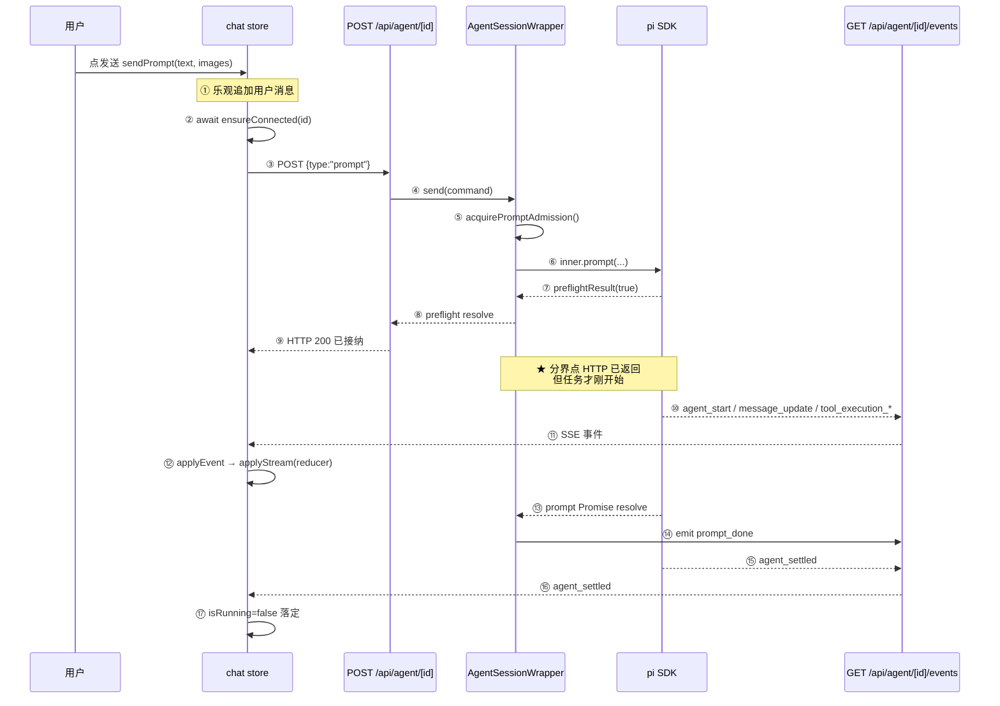
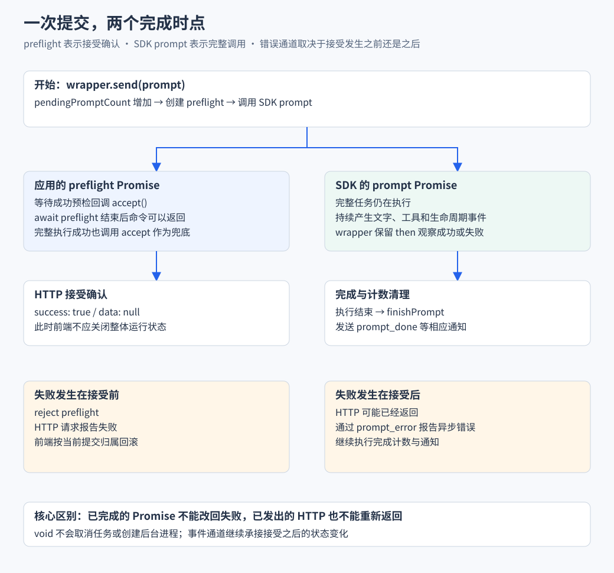

# 01 执行链路与流式传输

> 对应简历：**「在 Node 服务端集成 Pi Agent SDK，封装会话实例管理与命令分发，将模型文本、思考及工具调用等事件适配为前端事件，通过 SSE 持续推送；区分命令接纳与整轮任务完成两个时点，避免长任务阻塞请求及前端提前清理运行状态。」**

---

## Q1 这个项目解决什么问题？为什么做成 Web 工作台，而不是直接用 CLI？

**核心结论**：pi 本身是个终端里的 AI 编程 Agent，能力已经完整。它缺的不是「能跑」，而是**过程不可见**和**结果不可回溯**。这个项目补这两层，执行内核一行没改。

终端里跑 Agent 有三个具体不便：

| 问题 | 终端里的表现 | Web 端怎么做 |
| --- | --- | --- |
| 过程不可见 | 思考、工具调用一闪而过，滚上去找不回来 | 思考块和工具卡片结构化保留，工具参数和结果在同一张卡片里 |
| 无法回溯分叉 | 想回到第 3 轮重新问，只能重开一个会话 | 会话是 append-only 的树，可以导航到任意历史节点开新分支 |
| 多会话难管理 | 一个终端窗口一个会话，切换靠记忆 | 侧栏列表 + 运行中标记 + 工作区分组 |

**为什么能只做观察层，而不碰执行内核**

关键在于 SDK 已经把「执行过程」抽象成了事件流（`agent-session.d.ts:280` `subscribe(listener)`）：

```text
Agent 执行（SDK 负责）          ← 与呈现无关，终端和 Web 共用
    ↓ 产生事件
事件流（SDK 暴露 subscribe）    ← 唯一的耦合点
    ↓
呈现层（终端 TUI / Web UI）      ← 各自实现，互不影响
```

如果 SDK 没有事件机制，做 Web UI 就必须改 SDK 源码——那样就会和 CLI 分叉，两边再也无法共享同一份执行逻辑。所以这个项目的可行性，本质上建立在 SDK 的事件抽象上。

**为什么不是另外两条路**

| 方案 | 优点 | 代价 | 为什么不选 |
| --- | --- | --- | --- |
| **复用 SDK + 事件流**（当前） | 执行能力零成本，与 CLI 共享会话 | 受 SDK 事件结构约束，必须做适配层 | — |
| 自己实现 Agent 循环 | 完全可控 | 要重做工具执行、模型调用、上下文管理、压缩 | 工程量数倍，且做不出比上游更可靠的执行内核 |
| 改 SDK 源码 | 能解决所有限制 | 与上游脱钩，CLI 侧受影响，升级困难 | 一个 UI 项目不该让 CLI 承担分叉成本 |

真正的证据是**复用 pi CLI 的会话文件**（`rpc-manager.ts:484-488`）：

```ts
const sessionManager = sessionFile ? SessionManager.open(sessionFile) : SessionManager.create(cwd!)
// 会话文件头里的 cwd 才是权威的 不能用调用方传入的 cwd
const sessionCwd = sessionManager.getCwd()
```

会话文件格式是 SDK 的既定契约，Web 端没有另起一套存储。在终端里开的会话，网页上能接着聊。

**这个定位的代价**

- 必须兼容 CLI 的配置目录 `~/.pi/agent`，包括文件锁行为（`agent-services.ts` 整个文件在处理这个）
- 会话文件格式由 SDK 决定，Web 端不能自由设计数据结构

**口述版**

> pi 是个终端里的 AI 编程 Agent，能力已经很强。但它有两个问题：一是执行过程看不见——读了哪些文件、调了哪些工具、思考了什么，在终端里一闪而过，滚上去就找不回来；二是没法回看和分叉，想回到之前某一步重新问是不行的。
>
> 我做的这层 Web 界面就是补这两个能力。这里有个关键判断：**Agent 的执行过程和它的呈现方式是可以分离的**。SDK 已经把执行过程抽象成了事件流，所以我不需要改执行内核，只需要消费这个事件流，把它投影成 Web 界面。这个判断决定了项目的可行性——如果 SDK 没有事件机制，做 Web UI 就必须改 SDK 源码，那样就会和 CLI 分叉，两边再也无法共享同一份执行逻辑。
>
> 我考虑过另外两条路。自己实现 Agent 循环，工程量是数倍，而且做不出比上游更可靠的执行内核；改 SDK 源码能解决所有限制，但会让 CLI 侧承担分叉成本——一个 UI 项目不该这么做。所以最后选的是在调用侧适配。
>
> 我复用了 pi 的会话文件格式，所以 Web 端和 CLI 共享同一批会话，在终端里开的会话在网页上能接着聊。代价是必须兼容 CLI 的配置目录和文件锁行为，会话文件格式也由 SDK 决定，Web 端不能自由设计数据结构。

**追问链**

```text
Q: 那你的项目本质上是「给 SDK 套了个壳」？
A: 不是。壳是只做展示，但这里要处理 Web 场景特有的问题：
   浏览器会刷新、网络会断、多个请求会并发、用户会快速切会话。
   这些在终端里都不存在，因为终端是一个长驻进程加一条同步的 stdin。
   我写的是会话实例的并发管理、事件的跨进程协议、前端的状态一致性。

Q: 为什么不直接用现成的 Web 版 Agent 产品？
A: 这个项目的定位是「自己的 Agent 的 Web 界面」，
   要能共享本地的配置、技能、扩展和会话历史。

Q: 最难的部分是什么？
A: 不是渲染，是异步状态一致性。见 Q5、Q17。
```

---

## Q2 用户发一句话之后，完整执行链路是什么？

**核心结论**：分**接纳**和**执行**两阶段，分界点是 `preflightResult` 回调。



| # | 位置 | 做什么 |
| --- | --- | --- |
| ① | `chat.ts:618-625` | 乐观追加 + `isRunning = true` |
| ② | `chat.ts:637-640` | `await connection.ensureConnected(id)` |
| ③ | `shared/lib/agent-client.ts` | `POST /api/agent/${id}` |
| ④ | `index.post.ts:14-24` | 查存活实例，否则冷启动 |
| ⑤ | `rpc-manager.ts:389` | 抢接纳链 |
| ⑥ | `rpc-manager.ts:412` | `inner.prompt(...)` |
| ⑦ | `rpc-manager.ts:418-420` | `preflightResult: (ok) => { if (ok) accept() }` |
| ⑧⑨ | `rpc-manager.ts:447` | `await preflight` → HTTP 返回 |
| ⑩⑪ | `rpc-manager.ts:155-160` | `subscribe` → `emit` 广播 |
| ⑫ | `event-stream.ts:85-89` | 裁剪 → `encode` → 写入流 |
| ⑬ | `chat.ts:312` / `:210` | `applyEvent` → `applyStream` |
| ⑭ | `rpc-manager.ts:428-434` | `prompt.then` → `emit prompt_done` |
| ⑮⑯⑰ | `chat.ts:396-410` | `agent_settled` 落定 + reload 对账 |

**三个「看起来多余」的设计，各自防一个真实故障**

| 设计 | 不这么做会怎样 |
| --- | --- |
| **先握手再发 prompt**（`chat.ts:637-640`） | 如果 POST 先到、SSE 后建，服务端已经推完的事件没有订阅者，前端永远收不到。表现是「短回复偶尔不出现」 |
| **乐观追加**（`chat.ts:618-625`） | 冷启动握手要数秒（要打开会话文件、建 services），不这样做界面像卡住，用户会重复点击发送 |
| **落定只认 `agent_settled`**（`chat.ts:396-410`） | 重试/压缩/排队会让 `agent_end` 来多次，提前落定会让界面显示空闲但任务还在跑 |

**为什么是这三个顺序，而不是别的**

这三个设计都来自同一个约束：**浏览器和服务端之间没有共享内存，所有状态同步都是异步的**。乐观追加是把「用户已经表达了意图」这件事立刻反映到界面，不等服务端确认；先握手是把「通道可用」作为发命令的前置条件；落定认 `agent_settled` 是因为只有它是「这个会话彻底没活了」的权威信号。

**口述版**

> 分接纳和执行两个阶段，分界点是 SDK 的 `preflightResult` 回调。
>
> 用户点发送，前端先做乐观追加——把用户消息直接放进列表，`isRunning` 置为 true。因为 SSE 冷启动握手要几秒，要打开会话文件、初始化 services，不这样做界面会像卡住，用户可能重复点击。然后**等握手完成再发 POST**，这个顺序不能反，否则服务端推的第一批事件没有订阅者，短回复会偶尔不出现。
>
> 服务端收到命令，先从实例注册表拿存活的会话对象，没有就冷启动一个，然后调 SDK 的 `prompt()`。SDK 同步校验通过后回调 `preflightResult(true)`，这时候 HTTP 就返回 200 了——这只是「命令被接纳」，任务才刚开始。
>
> 之后 SDK 跑执行循环，产生文本增量、思考增量、工具调用这些事件。wrapper 订阅到后广播给 SSE 流，流做一次裁剪再序列化成 `data: {...}` 写出去。前端 `EventSource` 收到交给 `applyEvent` 分发，流式内容走纯函数 reducer 按 `contentIndex` 组装。
>
> 最后 SDK 的 prompt Promise resolve，wrapper 发一个自己造的 `prompt_done`，再往后 SDK 发 `agent_settled`，前端这时候才把 `isRunning` 置为 false 并 reload 对账。之所以落定不认 `prompt_done`，是因为一个逻辑 run 里可能还有自动重试、压缩、排队续跑，`agent_end` 会来好几次，只有 `agent_settled` 表示彻底结束。
>
> 这三个设计——乐观追加、先握手、认 `agent_settled`——背后是同一个约束：浏览器和服务端没有共享内存，所有同步都是异步的。所以界面要立刻反映用户意图，通道要确认可用才发命令，落定要找最权威的那个信号。

**追问链**

```text
Q: 为什么落定要认 agent_settled 而不是 prompt_done？
A: 一个逻辑 run 里可能还有自动重试、压缩、排队后的续跑，
   agent_end 会来好几次。agent_settled 是 SDK 原生的
   「彻底没活了」信号，见 Q5。

Q: 乐观追加的消息怎么去重？
A: userMessageKey = role + 文本 + 时间戳取整到秒（chat.ts:41-46）。
   message_end 到达时比对列表末尾，key 相同跳过，
   不同就用服务端版本替换。

Q: 如果 POST 返回 500 呢？
A: 回滚乐观消息——只撤仍在列表末尾的那条，用 toRaw 做身份比较，
   避免误删服务端已追加的消息（chat.ts:627-634）。
   保留用户输入，提示「提交结果未确认 请先核对会话再重试」，不自动重发。
```

---

## Q3 为什么 Agent 必须在 Node 服务端执行？

**核心结论**：三个硬约束，任何一个单独成立就足够：**工具要碰本机文件系统**、**模型凭证不能下发**、**任务要比页面活得久**。

| 约束 | 具体内容 | 浏览器为什么不行 |
| --- | --- | --- |
| **工具执行** | `read`/`write`/`edit` 要任意路径读写，`bash`/`powershell` 要启动子进程，`grep`/`find` 要遍历目录树 | File System Access API 只给「用户授权过的几个文件」，和 Agent 需要的「整个工作区」差几个量级 |
| **凭证** | 模型 API Key 必须在服务端 | 浏览器直接调模型，打开 DevTools 就能拿走，损失是按 token 计费的真实成本 |
| **任务生命周期** | Agent 任务可能跑几分钟 | 关标签页、刷新、被系统回收，任务都会消失 |

代码体现：`nuxt.config.ts:7` `ssr: false`（纯 SPA，无 SEO 需求）；`nuxt.config.ts:35-43` 把 SDK 排除出打包（它是纯 ESM 且内嵌 WASM 的重包，只能在 Node 侧运行）；`nuxt.config.ts:9` 绑 `127.0.0.1`。

**这个约束最重要的连带后果**

**前端不能是事实来源，只能做投影**。所以前端不做业务决策，只回答「这个异步结果还算不算数」。真正的业务判断在 SDK 里——`usePromptQueue.ts:51` 的注释原文：

> SDK 在接纳时判断入队或开启新轮 前端不根据过时的运行状态猜测

**为什么不做成本地应用**

技术上 Electron 可行，但 Web 的部署和访问成本更低，而且这个项目定位是本地工具，绑在 `127.0.0.1` 上跑就够了。Electron 会引入额外的打包和更新复杂度，换来的能力（本地文件系统访问）服务端本来就有。

**口述版**

> 三个硬约束。
>
> 第一，工具执行。Agent 的核心价值是能读文件、改代码、跑命令，浏览器沙箱里全做不了。就算用 File System Access API 也只是用户授权过的几个文件，和 Agent 需要的整个工作区差几个量级。
>
> 第二，凭证。模型 API Key 必须留在服务端，否则打开 DevTools 就能拿走，损失是按 token 计费的真实成本。
>
> 第三，任务生命周期。Agent 任务可能跑几分钟，放在浏览器里用户关掉标签页任务就没了。放在服务端，关掉页面任务继续跑，重新打开还能看到结果。
>
> 这个约束有个最重要的连带后果：**前端不能是事实来源，只能做投影**。所以前端不做业务决策，只回答「这个异步结果还算不算数」这种状态判断。真正的业务判断在 SDK 里——比如消息是入队还是开新轮，前端不根据过时的运行状态猜，这是代码注释里明确写的。
>
> 我也考虑过 Electron 这类本地应用。技术上可行，但 Web 的部署和访问成本更低，而且这个项目定位就是本地工具，绑在 127.0.0.1 上跑就够了，Electron 换来的能力服务端本来就有。

**追问链**

```text
Q: 前端到底负责什么？
A: 只做投影和交互。把服务端推来的事件组装成消息和工具状态再渲染，
   以及处理「异步结果是否还有效」这类守卫。

Q: 要做成多用户呢？
A: 当前设计不支持。需要用户隔离的会话目录、API 鉴权、
   工具执行的权限边界（现在 Agent 能执行任意命令）、
   实例注册表移到共享存储。

Q: 为什么绑 127.0.0.1？
A: 因为 API 无鉴权且 Agent 能执行任意命令。
   绑 0.0.0.0 的话，同一网络里任何人都能通过这个接口
   在你机器上执行命令。
```

---

## Q4 Pi Agent SDK 提供了哪些能力？你自己写了什么？

**核心结论**：SDK 提供「Agent 能跑」，项目提供「Agent 跑的过程能被浏览器实时看到、能控制、并且不会因为网络和长任务把状态搞乱」。

**SDK 提供的（版本 0.85.1）**

| 能力 | 证据 |
| --- | --- |
| Agent 执行循环、模型调用 | `agent-session.d.ts:192` `AgentSession` 类 |
| 工具注册与执行 | `agent-session.d.ts:120-132` |
| 会话文件 JSONL 读写、entry 树 | `SessionManager` |
| **上下文压缩算法**（手动 + 自动阈值/溢出） | `agent-session.d.ts:515`；`compaction.js:160-164` |
| 上下文占用估算 | `agent-session.d.ts:642` `getContextUsage()` |
| 分支导航底层 | `agent-session.d.ts:618` `navigateTree()` |
| `agent_settled` / `queue_update` / `compaction_*` 事件 | `agent-session.d.ts:47-101` |
| 运行中消息队列（steer / followUp） | `agent-session.d.ts:375/383/430` |
| `preflightResult` 钩子 | `agent-session.d.ts:159`（注释：Internal hook used by RPC mode） |

**项目自研的**

| 能力 | 位置 |
| --- | --- |
| 会话实例注册与并发合并 | `rpc-manager.ts:466-498` |
| 命令分发与忙判定 | `rpc-manager.ts:202-370` |
| **两个完成时点的拆分** | `rpc-manager.ts:403/410` |
| 接纳串行链 | `rpc-manager.ts:378-386` |
| **`prompt_done` / `prompt_error` / `connected` / `startup_error` 事件** | `rpc-manager.ts:434/441`、`event-stream.ts:124/136` |
| 事件裁剪与 wire 协议 | `agent-event-wire.ts:68` |
| SSE 通道与快照重放 | `event-stream.ts:32-162` |
| 前端连接保活与旧连接隔离 | `agent-event-connection.ts` |
| 空闲回收（10 分钟） | `rpc-manager.ts:93/165-176` |
| SDK 文件锁冲突重试 | `agent-services.ts:21-35` |
| 流式消息 reducer | `streaming-message.ts:129` |
| 三层判据 + 队列版本 | `chat.ts:102-103`、`usePromptQueue.ts:31` |

**怎么快速自检**：看代码在哪个目录（`node_modules/@earendil-works/` 是 SDK，`server/`、`app/`、`shared/` 是项目），或者看事件名能不能在 SDK 里搜到——`prompt_done`、`prompt_error`、`connected`、`startup_error` 这四个都是项目自造的，SDK 里零匹配。

**一个容易被忽略的自研点：SDK 锁冲突重试**

`agent-services.ts` 全文 35 行，解决一个真实的跨平台问题：pi CLI 和 pi-web 会同时运行并共享 `~/.pi/agent`，SDK 用文件锁保护并发写，但 Windows 上 `mkdir`/`rmdir` 有竞态，抛出的 `EPERM` 是瞬时冲突不是权限问题。

```ts
// 只匹配锁路径上的文件系统错误 其他错误原样抛出避免掩盖真实故障
const isTransientLockError = (error: unknown): boolean => {
  const message = error instanceof Error ? error.message : String(error)
  return /\.lock/.test(message) && /(EPERM|EACCES|EEXIST|ENOTEMPTY|EBUSY)/.test(message)
}
```

重试用指数退避（`:32`）：150 / 300 / 600 / 1200 / 2400 毫秒，最多 5 次。

**为什么在调用侧重试，而不是改 SDK**：因为改 SDK 会影响 pi CLI——它是另一个使用方，不该为 Web 端的问题承担分叉成本。这是接入第三方库时的正确姿势：**优先在调用侧适配，不要 fork 依赖**。

**主动说明的边界**

| 容易说错的点 | 事实 |
| --- | --- |
| 「我实现了上下文压缩算法」 | 压缩是 SDK 的，我只做事件对接和状态展示 |
| 「`agent_settled` 是我合成的落定事件」 | SDK 原生事件（`agent-session.d.ts:47`），只在断线重连补偿路径合成过一次（`chat.ts:325`） |
| 「我实现了 fork」 | **未实现**。`rpc-manager.ts:365-366` 是抛错占位，全仓 `app/`、`tests/` 零 `fork` 调用。分支走 `navigate_tree` |
| 「我调了 SDK 的 getSessionStats」 | **没有调用**。项目用自研的 `computeSessionStats` 从会话文件复刻了同一口径 |

**口述版**

> 我按「执行能力」和「接入能力」划分。
>
> **SDK 提供执行能力**：Agent 执行循环、模型调用、工具注册与执行、会话文件读写、上下文压缩算法、分支导航的底层实现，以及一堆事件——`agent_settled`、`queue_update`、`compaction_start/end`、`auto_retry_*` 都是 SDK 原生的。
>
> **我写的是接入能力**，四块。
>
> 一是服务端的会话实例封装。SDK 的 `AgentSession` 是有状态的重对象，不能每个请求建一次。我用注册表做跨请求复用，还有一个 locks 表把「正在创建中的 Promise」也共享出去——因为初始化要打开文件、建 services，耗时几百毫秒到几秒，这期间两个请求同时进来会建出两个实例，两个 Agent 同时往同一个会话文件写。
>
> 二是事件适配。SDK 事件是给终端 UI 用的，里面带巨大的 `partial` 全量快照，直接扔进 HTTP 流的话流式回复的传输量是平方级的。三是两个完成时点的拆分。四是前端的流式状态管理和异步竞态处理。
>
> 有一条边界我会主动说明：压缩是 SDK 做的，我只是对接事件和展示状态。还有 `fork` 在我的项目里没实现，是抛错占位，分支能力走的是 `navigate_tree`——它在同一个会话文件里移动指针，和 fork 创建新文件的语义完全不同。
>
> 另外有个自研的小点值得一提：SDK 用文件锁保护 `~/.pi/agent` 的并发写，但 Windows 上 `mkdir`/`rmdir` 有竞态会抛 `EPERM`，那其实是瞬时冲突不是权限问题。我在自己这侧做了指数退避重试就解决了，没有去改 SDK——因为 pi CLI 是另一个使用方，不该为 Web 端的问题承担分叉成本。

**追问链**

```text
Q: 你怎么判断一个功能是 SDK 的还是你的？
A: 看代码在哪个目录，或者看事件名能不能在 SDK 里搜到。

Q: 你改过 SDK 吗？
A: 没有。文件锁冲突在自己这侧重试解决了，理由是对 pi CLI 零影响。

Q: 有没有 SDK 能做但你没用的能力？
A: getSessionStats() 没调，而是自己从会话文件复刻了同一套口径，
   因为要在服务端读文件时顺便算出来。exportToHtml 也没用。
   另外我自己写的 buildSessionContext 返回了 oldestEntryId
   和 hasMore（session-reader.ts:347-348），是给分页准备的，当前没做分页。
```

---

## Q5 命令接纳与整轮完成为什么是两个时点？

**核心结论**：HTTP 的返回时机由 `preflight` 决定，任务的结束时机由 `prompt` 决定，两者不是同一个 Promise。再加 SDK 原生的 `agent_settled` 作为最终落定点，一共三个时点。



**核心代码只有几行**

```ts
// rpc-manager.ts:403-409 手写一个外部可控的 Promise
const preflight = new Promise<void>((resolve, reject) => {
  accept = () => { accepted = true; resolve() }
  rejectFn = reject
})

// rpc-manager.ts:412-421 把回调交给 SDK
prompt = this.inner.prompt(String(command.message), {
  source: "rpc",
  preflightResult: (ok: boolean) => { if (ok) accept() },
})

// rpc-manager.ts:428-434 整轮结束才走这里
void prompt.then(() => {
  accept()
  this.finishPrompt()
  if (!streamingBehavior) this.emit({ type: "prompt_done" })
})

// rpc-manager.ts:447 HTTP 在这里返回
await preflight
```

**每一步去掉会怎样**

| 步骤 | 行号 | 去掉会怎样 |
| --- | --- | --- |
| 抢接纳链 | 389 | 并发 prompt 都读到「未流式」，SDK 只允许一个 run |
| 忙判定 | 391-397 | 导航或压缩中接纳 prompt，消息链会错乱 |
| 计数 +1 | 398 | `isRunning()` 不会立刻为真 |
| 建 preflight | 403-409 | 没有「外部可控」的 Promise，无法分离两个时点 |
| **同步抛错兜底** | 422-426 | **`pendingPromptCount` 永久泄漏，`isRunning()` 恒为真** |
| 挂整轮回调 | 428-445 | 前端不知道整轮结束了 |
| 释放锁 | 450 | 接纳链死锁 |

**同步抛错兜底是最容易漏的一行**。如果抛错时不减回去，`isRunning()` 永远返回 true，`/api/agent/running` 会一直报这个会话在运行，前端显示「正在思考」但实际什么都没发生。

**三个时点对照**

| 时点 | 谁产生 | 前端应该做什么 |
| --- | --- | --- |
| **命令接纳** | 项目（`preflight`） | 知道「命令收下了」，但**不要**停止 loading |
| **整轮结束** | 项目（`prompt_done`） | 仅当 SDK 没起来时（纯斜杠命令）才落定 |
| **完全落定** | SDK（`agent_settled`） | 置 `isRunning = false`，reload 对账 |

**为什么不能只有一个时点**

如果 HTTP 等到整轮结束才返回，会有三个问题：

| 问题 | 具体表现 |
| --- | --- |
| 长任务阻塞请求 | Agent 跑 10 分钟，POST 挂 10 分钟；中间网络抖动导致请求失败，但服务端 Agent 还在跑 |
| 撞超时 | Nginx（默认 60s）、浏览器、Node 各自的超时必然被触发 |
| **无法区分「发失败」和「跑失败」** | 一个 500 可能是「命令没被接受」，也可能是「接受后执行崩了」，前端处理方式完全不同 |

反过来，如果前端在 POST 返回时就把 `isRunning` 置 false：任务还在跑，界面显示空闲，用户可能再发一条，或者以为可以安全关页面。

**为什么需要第三个时点**

`agent_settled` 是 SDK 原生事件，SDK 描述「空闲」的语义是（`agent-session.d.ts:296` 注释）：

> Whether the session has no active agent run, compaction, branch summary, retry, or queued continuation.

`agent_end` 只是「一轮结束了」，后面可能还有重试和压缩。所以 `chat.ts:390-394` 的注释写着「落定只认 agent_settled」。

**这个设计的通用性**：任何「提交长任务」的场景都会遇到同样的问题。解法是把「接纳确认」和「完成通知」拆成两个通道——接纳走同步响应，完成走异步事件。这在消息队列、批处理、CI 触发里都是同一个模式。

**局限**

| 局限 | 说明 |
| --- | --- |
| 没有命令 ID | 网络重试可能导致重复 prompt，没有幂等保护 |
| `prompt_done` 是自定义事件 | 不在 SDK 契约里，是项目自己维护的协议 |
| `agent_settled` 不可重放 | 断线期间发出就永久丢失，只能靠 `connected` 的 `isStreaming: false` 推断 |

**口述版**

> 出发点是：Agent 任务可能跑很久，但 HTTP 请求不能一直挂着。
>
> 我把一次 prompt 拆成两个 Promise。第一个是「命令接纳」——SDK 收到 prompt 后会做同步校验，比如模型有没有配、API Key 在不在、扩展的预检过不过，它通过一个 `preflightResult` 回调告诉我结果。我把这个回调接到一个自己创建的 Promise 上，HTTP 请求就等这个 Promise，一旦接纳就返回 200。第二个是「整轮完成」——SDK 的 `prompt()` 返回的 Promise，要等整个 run 跑完才 resolve，我在它的 `then` 里发一个自己造的 `prompt_done` 事件，通过 SSE 推给前端。
>
> 如果合成一个时点会有三个问题：长任务阻塞请求、必然撞超时、以及无法区分「发失败」和「跑失败」——一个 500 可能是命令没被接受，也可能是接受后执行崩了，前端处理方式完全不同。反过来如果前端在 POST 返回时就把 `isRunning` 置 false，任务还在跑但界面显示空闲，用户可能再发一条。
>
> 还有第三个时点：真正把 `isRunning` 置为 false 要等 SDK 原生的 `agent_settled` 事件。因为一个逻辑 run 里可能包含自动重试、上下文压缩、排队后的续跑，`agent_end` 会来好几次，只有 `agent_settled` 表示这个会话彻底没活了。
>
> 有一个细节是最容易漏的：SDK 同步抛错的时候我也必须调一次 `finishPrompt()`。因为我在发 prompt 前把 `pendingPromptCount` 加了 1，如果抛错路径不减回去，这个计数就永久泄漏，`isRunning()` 永远是 true，接口会一直报这个会话在运行，但实际什么都没发生。
>
> 这个模式不只适用于 Agent。任何「提交长任务」的场景都是同一个问题，解法就是把「接纳确认」和「完成通知」拆成两个通道——接纳走同步响应，完成走异步事件。消息队列、批处理、CI 触发都是这个套路。

**追问链**

```text
Q: 如果 SDK 回调 preflightResult(false) 会怎样？
A: accept() 不被调用，preflight 一直 pending。
   但 prompt.then 的 rejection 分支会调 rejectFn(e)，HTTP 返回错误。

Q: finishPrompt 漏调会怎样？
A: pendingPromptCount 永远 > 0 → isRunning() 恒为真
   → /api/agent/running 一直报这个会话在跑。

Q: prompt_done 为什么只在非 streamingBehavior 时才发？
A: 带 streamingBehavior 的是运行中追加（steer/followUp），
   它不是新的一轮，不该触发「整轮结束」的语义。
```

---

## Q6 会话实例为什么要注册表和启动合并？

**核心结论**：`AgentSession` 是有状态的重对象，初始化耗时几百毫秒到几秒。只保存「已完成」的实例填不上这个空档，两个并发请求会建出两个执行对象，同时往同一个会话文件写。

```ts
// rpc-manager.ts:466-468
// 会话 id → 已完成的存活 wrapper 跨请求复用同一执行对象
const registry = new Map<string, AgentSessionWrapper>()
// 会话 id → 正在创建的 Promise 初始化期间合并并发 防止建出两个实例
const locks = new Map<string, Promise<{ session: AgentSessionWrapper; realSessionId: string }>>()
```

**两级复用的逻辑**（`startRpcSession`）：先查 `registry` 拿存活实例，查不到再查 `locks` 拿在途的初始化 Promise。

**三个容易漏掉的点**

**① 只存 registry 不够**——初始化要打开文件、建 services、建 `AgentSession`，中间有多个 `await`。这期间两个请求同时进来，两边都查不到 `registry`，就会各建一个执行对象。`locks` 把在途的初始化 Promise 也共享出去，第二个请求直接 await 同一个 Promise。

**② 注册用真实 id 而不是入参**——新会话场景下真实 id 要等 SDK 创建后才存在：

```ts
const realId = session.sessionId
registry.set(realId, wrapper)   // ← 不是入参 sessionId
```

新建会话时调用方传的是 `` `__new__${randomUUID()}` `` 这样的临时 key。**为什么用随机 key**：如果两个新建请求共用一个固定 key，它们会被 `locks` 合并成同一个会话——用户点两次「新建」拿到同一个会话。

**③ `.finally()` 保证锁必然释放**——即使初始化抛错也会执行。否则一次失败会让这个会话 id 永久锁死。

**运行状态的两个口径**

`isRunning()` 用两个条件的或：`pendingPromptCount > 0 || inner.isStreaming`。前者覆盖「命令已接纳但 SDK 还没开始流式」的空档，后者覆盖「SDK 正在产出但计数可能已减」的情况。

**空闲回收为什么是 10 分钟，为什么还要检查 listeners**（`rpc-manager.ts:165-176`）：

```ts
this.idleTimer = setTimeout(() => {
  if (this.listeners.size > 0) { this.resetIdleTimer(); return }
  this.destroy()
}, IDLE_RECYCLE_MS)
```

代码注释写明了不检查的后果：「流还连着但 wrapper 已销毁，新提问的事件无人接，前端卡在正在思考」。**销毁顺序也有讲究**：先通知 `disposeListeners` 关流，再 dispose inner——顺序反了的话 SSE 流会继续发心跳，前端以为连接健康。

**接纳串行链：另一层并发控制**

SDK 判断「入队还是开新轮」依赖当前的 `isStreaming` 状态。两个 prompt 并发进来，两边都读到「未流式」，就会都当成新轮——但 SDK 只允许一个 run。所以 `acquirePromptAdmission` 把接纳判断串行化。

**`clear_queue` 也要等这条链**（`:353-356`）：用户点停止时先撤回队列再 abort。如果撤回请求在某个 prompt 还在做接纳判断时插进去，可能撤到一个「即将被消费」的队列，撤回的内容就丢了。

**这个模式的通用性**：`registry + locks` 是「单飞（single-flight）」模式的标准实现——同一个 key 的并发请求合并成一个。在缓存穿透、配置加载、连接池初始化里都是同一个套路。

**局限**：`registry` 是进程内模块级 Map，多实例部署时同一会话在两个进程各建一个 AgentSession，同时写同一个 JSONL。

**口述版**

> 因为 `AgentSession` 是个有状态的重对象，初始化要打开会话文件、建 services、建 session，中间有多个 await，耗时几百毫秒到几秒。这个对象不能每个请求建一次。
>
> 我用了一个两级复用的结构。第一级是 registry，保存已经创建完成的存活实例。第二级是 locks，保存「正在创建中的 Promise」。
>
> **只保存 registry 是不够的**——这正好是初始化空档的问题。两个请求同时进来，都查不到 registry，就会各建一个执行对象，两个 Agent 同时往同一个会话文件写，结果不可预期。所以我把在途的初始化 Promise 也存进 locks，第二个请求直接 await 同一个 Promise。
>
> 三个细节容易漏。一是注册时用的是 SDK 返回的真实 id，不是调用方传进来的 key，因为新建会话时真实 id 要等创建完才有。二是新建会话用随机 tempKey，如果两个新建请求共用一个固定 key，它们会被 locks 合并成同一个会话，用户点两次「新建」会拿到同一个。三是用 `.finally()` 保证锁必然释放，否则一次失败会让这个 id 永久锁死。
>
> 另外还有一层并发控制是接纳串行链。SDK 判断「入队还是开新轮」依赖当前的流式状态，两个 prompt 并发进来都读到「未流式」，就会都当成新轮，但 SDK 只允许一个 run。所以我把接纳判断串行化了。撤回队列也要等这条链，否则可能撤到一个即将被消费的队列，撤回的内容就丢了。
>
> 这个 registry + locks 的结构其实是「单飞」模式的标准实现——同一个 key 的并发请求合并成一个。缓存穿透、配置加载、连接池初始化都是同一个套路。局限是 registry 是进程内 Map，多实例部署会冲突。

**追问链**

```text
Q: 多进程部署会怎样？
A: registry 是进程内 Map，同一会话在两个进程会各建一个 AgentSession，
   同时写同一个 JSONL 文件。要支持多实例需要把注册表移到共享存储，
   再加会话级的分布式锁。当前设计是单进程假设。

Q: 空闲回收为什么是 10 分钟？为什么还要检查 listeners？
A: 10 分钟够用户在一个会话里思考。
   检查 listeners 是因为：如果浏览器还开着这个会话，
   销毁 wrapper 会让 SSE 流变成「连着但收不到事件」的死连接。

Q: destroy 为什么先通知 disposeListeners 再 dispose inner？
A: 让 SSE 流先关闭，前端 onerror 会重连到重建的 wrapper。
   顺序反了的话流会继续发心跳，前端以为连接健康。
```

---

## Q7 SDK 事件为什么要裁剪？裁掉了什么，代价是什么？

**核心结论**：SDK 的 `message_update` 事件带一个 `partial` 字段——**当前消息的全量快照**。流式回复时增量事件几百条，每条都带全量，传输量是 **O(n²)**。

`agent-event-wire.ts` 文件头注释（`:2-5`）：

> 丢掉 turn_start turn_end 剥掉 message_update 里巨大的 partial 快照字段 / 把 toolcall 的 id toolName 提升到事件顶层 / **不做这层过滤 每次增量都带全量内容 流量与 CPU 都会爆炸**

**裁剪清单**

| 裁剪内容 | 理由 |
| --- | --- |
| 整个事件类型 `turn_start` / `turn_end` | 前端完全不用这两个类型 |
| `message_update.assistantMessageEvent.partial` | **最大的一项**，全量快照 |
| `agent_end.messages` 和 `willRetry` | 前端靠 reload 读权威数据 |
| `tool_execution_update` 收窄为 4 个字段 | 只传进度相关的 |

**一个必须讲清楚的因果链**

```text
剥掉 partial
  ↓
工具调用的 id 和 toolName 也一起没了
（它们藏在 partial.content[contentIndex] 里）
  ↓
所以必须在剥之前先把它们摘出来
  ↓
toolCallMetadata() 做这件事
```

`toolCallMetadata` 还对 `id`/`toolCallId`、`name`/`toolName` **两套字段名都做了兼容**——SDK 在不同事件路径上用的字段名不一致，`normalize.ts:2-3` 的注释印证了这一点。

**传输量的量化**

假设一次回复 2000 token，按增量到达约 500 条事件。第 i 条事件的 `partial` 长度正比于 i：

```text
总传输量 ≈ Σ(i=1..500) i × 4 字符 ≈ 501,000 字符
完整回复 ≈ 2000 × 4 = 8,000 字符
倍数 ≈ 62 倍（且随回复长度平方增长）
```

裁剪后每条只传增量本身，总量约等于完整回复大小。

> **这是从数据结构推算，不是实测数据**。面试时说「从数据结构推算」而不是「我测过」。

**第二层价值：防腐层**

```text
SDK 事件结构 ──[toClientAgentEvent]──→ wire 事件（项目自己的契约）
                      ↑
                唯一需要改的地方
```

SDK 升级改字段名，只改这一个函数，前端不动。这也是为什么 `shared` 层不能 import pi 包——`agent-event-wire.ts:13-14` 注释写明「shared 层不允许 import pi 包，这是打进浏览器产物的前提」，因为 SDK 是纯 ESM 且内嵌 WASM 的重包。

**代价**

| 裁剪 | 代价 |
| --- | --- |
| 剥 `partial` | 必须提前提升工具元数据，多一次解析 |
| `agent_end` 削空 | 前端无法判断是否会重试，只能无条件 reload；重试状态改由 `auto_retry_*` 传达 |

**口述版**

> SDK 的事件是给终端 UI 用的，直接扔进 HTTP 流有两个问题。
>
> 一是 `message_update` 里带一个 `partial` 字段，是当前这条消息的**全量快照**。流式回复时增量事件可能几百条，每条都带全量，传输量就是平方级的——从数据结构推算，一次 2000 token 的回复会产生相当于完整回复几十倍的传输量，而且回复越长倍数越大。
>
> 二是 `turn_start` 和 `turn_end` 这两个类型前端完全不用，可以直接丢。
>
> 但剥掉 `partial` 有个副作用：工具调用的 `id` 和 `toolName` 本来藏在 `partial.content[contentIndex]` 里，剥掉之后前端就拿不到了。所以我在裁剪时先把这两个字段提升到事件顶层，这样前端的 reducer 不用解 `partial` 也能拿到工具标识。
>
> 这层适配还有第二个价值：它是一道防腐层。SDK 升级改字段名，我只需要改 `toClientAgentEvent` 一个函数，前端完全不用动。另外 `shared` 层不能 import pi 包，因为 SDK 是纯 ESM 加内嵌 WASM 的重包，进不了浏览器产物。
>
> 代价也要说清楚：`agent_end` 被削成空对象后，前端无法从它判断这轮会不会重试，只能无条件 reload。重试状态改由 `auto_retry_start` 和 `auto_retry_end` 单独传达。

**追问链**

```text
Q: 丢掉 agent_end 的 willRetry 有什么影响？
A: 前端无法从 agent_end 判断这轮会不会重试，只能无条件 reload。
   重试状态改由 auto_retry_start / auto_retry_end 传达。

Q: 如果 SDK 加了新的事件类型呢？
A: toClientAgentEvent 的 default 分支是原样透传，
   所以新事件会自动到达前端。前端 applyEvent 的 default 是 break，
   不认识的事件会被忽略，不会报错。
```

---

## Q8 SSE 的三个必须保留的语义是什么？

**核心结论**：`event-stream.ts` 文件头注释写死了三个语义——**先开通道后握手**、**流式快照重放**、**心跳**。每一个都对应一个真实的坑。

**语义一：先开通道后握手**

冷启动要打开会话文件、建 services、建 AgentSession，耗时几百毫秒到几秒。这期间 SDK 可能已经开始产生事件，但监听器还没装上。解法是缓冲：握手前到达的事件先进 `bufferedEvents`，`connected` 发出后按序补发。

**顺序不能换**：`connected` 必须先于所有业务事件——前端 `ensureConnected` 就是在等这个信号。

**一个容易被忽略的实现细节**：流建立后要立即写一帧注释行（`:\n\n`）。因为 **SSE 的响应头只有在第一次写入时才真正发给浏览器**。不先写这一帧，浏览器侧一直是 pending，`EventSource` 的 `onopen` 不触发，用户看到「一直在连接」。

响应头里还有一个关键的：`X-Accel-Buffering: no`——告诉 Nginx 不要缓冲这个响应，否则事件会被攒起来批量发送，流式效果消失。

**语义二：流式快照重放**

用户刷新页面时 Agent 可能正在流式输出。刷新后新连接建立，但**刷新期间产生的增量事件全部丢了**。不补快照的话，前端会看到一个空的流式气泡。

**为什么快照是必要的，不是优化**：见 Q13 的推演——`updateContentBlock` 的守卫要求 `streamingMessage` 先存在，没有 `message_start` 的话所有 delta 都会被丢弃。**没有快照，流式气泡就永远是空的**。

前端收到后走 `snapshot` action，**整体替换**流式消息，不是追加。

**语义三：心跳**

每 30 秒发一个注释行。**为什么用注释行**：SSE 协议规定以冒号开头的行是注释，客户端会忽略内容但会刷新连接活跃度，不会污染业务事件流。**为什么是 30 秒**：常见中间层超时是 60 秒（Nginx `proxy_read_timeout` 默认值），留了一倍余量。

**快照去重**

快照重放带来新问题：缓冲事件里可能已经包含快照的内容。去重函数用的是**引用相等**：

```ts
// agent-event-wire.ts:112-119
return snapshot !== undefined
  && (event.type === "message_start" || event.type === "message_update")
  && event.message === snapshot
```

> **待核实**：仓库测试用手工构造的同一对象验证过逻辑，但**没有验证真实链路上 SDK 是否稳定复用同一对象引用**。如果 SDK 每次克隆 `message`，这条去重会失效，表现为快照与增量内容重复。

**一个真实的设计取舍**

`enqueueText` 写失败时调 `cleanup(false)`——清理监听器和定时器，但**不关闭 controller**。这意味着流会一直挂着，浏览器侧看起来连接还在，但服务端已经不再写任何数据，而且心跳也停了。

**为什么这么处理**：写失败通常意味着流已不可用，但主动 `close()` 可能抛错。选择保守处理（只清资源）的代价是浏览器侧感知不到。

**口述版**

> 文件头注释里写了三个必须保留的语义。
>
> 一是**先开通道后握手**：HTTP 响应头立即写出，但要等 agent 就绪、监听器装好才发 `connected`。期间 SDK 已产出的事件先进缓冲，握手后按序补发。这里有个容易忽略的细节——流建立后要立即写一帧注释行。因为 SSE 的响应头只有在第一次写入时才真正发给浏览器，不先写这一帧的话，冷启动几秒内浏览器侧一直是 pending，`EventSource` 的 `onopen` 不触发。另外响应头要带 `X-Accel-Buffering: no`，否则 Nginx 会缓冲这个响应，事件被攒起来批量发送，流式效果就没了。
>
> 二是**流式快照重放**：连接建立时如果 SDK 正在流式，立即补发一条 `message_start` 携带当前消息的完整快照。这不是优化而是必要的——因为 reducer 的守卫要求 `streamingMessage` 先存在，没有快照的话所有增量事件都会被丢弃，用户会看到一个空的流式气泡。
>
> 三是**心跳**：每 30 秒发一个注释行，防止中间层按空闲超时断连。用注释行是因为 SSE 规定冒号开头的行客户端会忽略，不会污染业务事件。30 秒这个值是因为常见中间层超时是 60 秒，留了一倍余量。
>
> 有一个细节要诚实说明：快照和缓冲事件之间有一个去重函数，用的是引用相等判断事件是否已包含在快照里。我在单测里用手工构造的对象验证过逻辑，但真实链路上 SDK 是否复用同一对象引用，我没有验证过。如果它每次克隆，这条去重会失效。

**追问链**

```text
Q: 为什么心跳用注释行而不是发一个事件？
A: SSE 协议规定以冒号开头的行是注释，客户端会忽略内容。
   用注释行不会污染业务事件流。

Q: 客户端断线后服务端的 Agent 会停吗？
A: 不会。Agent 执行在 wrapper 里，SSE 只是订阅者。
   这也是为什么关掉页面再打开能看到结果。

Q: 写失败后为什么不直接关闭流？
A: 因为 controller.close() 本身可能抛错。
   当前选择只清资源，代价是浏览器侧感知不到连接已经死了。
```

---

## Q9 前端怎么管理 SSE 连接？旧连接的事件会不会污染新连接？

**核心结论**：`AgentEventConnection` 做三件事——**业务握手**（等 `connected` 才能发命令）、**旧连接隔离**（三处归属判定）、**代次防串**（防止已停止的重试定时器把连接拉起来）。

**为什么必须自己包一层**

SSE 的 `EventSource` 自带重连，但它的重连是**无条件的**——它不知道「这个会话已经切走了」，也不知道「这个错误重试没用」。所以必须包一层加业务判断。

**三类真实故障与对应的防护**

| 故障 | 防护 |
| --- | --- |
| 命令发在握手之前，事件丢失 | `ensureConnected` 等 `connected` 事件 |
| 旧连接的回调迟到，污染新会话状态 | 三处 `this.current !== connection` 判定（`:91`、`:145`、`:173`） |
| 停止重连后被在途定时器拉起 | `retryGeneration` 代次比对（`:55`、`:199`、`:66-68`） |

**错误分类：什么该重试，什么不该**

| 错误类型 | 来源 | 是否重试 | 理由 |
| --- | --- | --- | --- |
| `startup_error` | 服务端发的业务错误 | ❌ | 重试也没用，是配置或环境问题 |
| `ready_timeout` | 握手超时 | ✅ | 可能是瞬时慢 |
| `closed` | 连接断开 | ✅ | 网络抖动 |

**一个设计得好的细节**：`startup_error` 时虽然停止重连，但**仍然把事件交给 `onEvent`**，让 UI 能提示用户。连接失败了，但错误信息得传达出去。

**`EventSource` 的一个坑**

它在 ready 之后如果连接又断了，`readyState` 可能停在 `CONNECTING` 而不触发 `onerror`。所以 `ensureConnected` 主动检查 `readyState`，不是 `OPEN` 就丢弃重连——代码注释写着「once ready 的 EventSource 可能一直停在 CONNECTING 不报错，主动丢弃重连」。

**连接保活的开关**：`shouldMaintain: (sid) => sid === sessionId.value`。切会话后旧连接的 sessionId 不再匹配，重连调度直接返回，不会把旧连接拉起来。用闭包而不是传值，是因为 `sessionId` 会变，闭包能读到最新值。

**口述版**

> 我在 `EventSource` 外面包了一层，因为原生的重连是无条件的——它不知道「这个会话已经切走了」，也不知道「这个错误重试没用」。
>
> 这层做了三件事。一是**业务握手**。服务端装好监听器、补发完快照后会发一个 `connected` 事件，`ensureConnected` 就是等这个信号。发 prompt 之前必须先 await 它，否则冷启动时服务端推的第一批事件没有订阅者，短回复会丢。
>
> 二是**旧连接隔离**。切会话或重连时会创建新连接，旧连接的回调可能迟到。我在三处都判断「这个回调所属的连接还是不是当前连接」，不是就直接返回。另外还有一个代次计数器，防止「已经主动停止重连了，但一个在途的重试定时器又把连接拉起来」。
>
> 三是**错误分类**。`startup_error` 是业务错误，重试没用，直接停止重连；`ready_timeout` 和 `closed` 是传输问题，3 秒后重试。这里有个细节值得一提：`startup_error` 的时候我虽然停止了重连，但仍然把这个事件交给上层处理，让界面能提示用户——连接失败了，但错误信息得传达出去。
>
> 还有一处是 `EventSource` 的一个坑：它在 ready 之后如果连接又断了，`readyState` 可能停在 `CONNECTING` 而不触发 `onerror`。所以我主动检查 `readyState`，不是 `OPEN` 就丢弃重连。
>
> 连接保活用一个 `shouldMaintain` 回调控制，切会话后旧连接的 sessionId 不再匹配，重连调度直接返回。这里用闭包而不是传值，是因为 sessionId 会变，闭包能读到最新值。

**追问链**

```text
Q: 为什么 readinessTimeoutMs 是 30 秒？
A: 冷启动要打开会话文件、建 services，可能几秒。
   30 秒是给慢机器留的余量，超时就当失败重连。

Q: reconnectDelayMs 是 3 秒，为什么不做指数退避？
A: 当前是固定延迟。指数退避对服务端持续不可用更友好，
   但这里是本地工具，服务端就在本机，3 秒够用。这是可改进的点。

Q: 断线期间的事件怎么办？
A: 永久丢失。重连后只能靠快照 + reload 对账，没有事件序号和游标。
```

---

## Q10 请求结束、连接关闭、任务结束有什么不同？

**核心结论**：三个是**完全独立**的事件，分属不同层次，可以任意组合。

| 概念 | 层次 | 谁触发 | 影响什么 |
| --- | --- | --- | --- |
| **请求结束** | HTTP | 服务端响应完 | 前端知道「命令被接纳了」 |
| **连接关闭** | 传输 | 网络断开 / 服务端关流 | 前端收不到后续事件 |
| **任务结束** | 业务 | SDK 执行完 | 任务真的完了 |

| 组合 | 场景 | 前端应该怎么做 |
| --- | --- | --- |
| 请求结束，任务进行中 | 正常情况 | 保持 `isRunning = true`，等 SSE 事件 |
| 请求结束，连接关闭，任务进行中 | 网络断开 | 重连，靠快照恢复流式气泡 |
| 请求结束，连接关闭，任务已结束 | 断线期间任务跑完了 | 重连后从 `connected.isStreaming: false` 推断，合成落定 |
| 请求失败，任务未启动 | preflight 拒绝 | 回滚乐观消息，提示错误 |
| **请求失败，任务已启动** | 接纳后连接异常 | **不能自动重试**，因为任务可能已经执行了 |

最后一行是 `chat.ts:669-673` 处理的，注释写着「连接错误可能发生在服务端已接纳之后，保留输入但不能自动重试」。

**SSE 自动重连能做什么**

| 能做 | 实现 |
| --- | --- |
| 断线后重新建立连接 | `scheduleRetry` → 3 秒后 `maintain` |
| 区分可重试与不可重试错误 | `startup_error` 不重试 |
| 避免重复重连 | `if (this.retry?.sessionId === sessionId) return` |
| 补发快照 | 服务端在 `connected` 后补发 `message_start` |
| 补发握手前缓冲的事件 | 服务端 `bufferedEvents` |

**不能做**：补发断线期间丢失的事件（服务端没有事件缓冲和序号）、知道断线期间发生了什么、判断任务是否被中断。

**关键区分**：

```text
SSE 自动重连  =  重新建立传输通道
业务事件恢复  =  把断线期间错过的事件补回来   ← 项目没有这个能力
```

**`connected` 的补偿逻辑**

如果断线期间任务结束了，`agent_settled` 是在没有连接的时候发出的，永久丢失。所以 `chat.ts:314-327` 加了一层判断：如果握手包说服务端没在跑（`isStreaming === false`），但本地 `sdkAgentActive` 还是 true，就主动合成一次 `agent_settled` 落定。

**为什么条件是 `sdkAgentActive`**：全新页面时它是 false，本来就没有残留状态需要清理。

**「重连」与「恢复」的边界**

| 层 | 重连能解决 | 重连解决不了 |
| --- | --- | --- |
| 传输 | 连接断了再建 | — |
| 状态 | 通过快照恢复流式气泡 | 断线期间的增量 |
| 业务 | 通过 `isStreaming` 判断任务是否还在跑 | 任务是否被中断过 |
| 数据 | 通过 reload 拿到最终结果 | 中间过程（工具执行细节） |

**一句话**：当前方案的可靠性建立在 **reload 兜底**上，而不是 **事件不丢**上。

**口述版**

> 这三个是完全独立的事件，分属不同层次。
>
> 请求结束是 HTTP 层的，它只说明「命令被接纳了」。连接关闭是传输层的，说明前端收不到后续事件了。任务结束是业务层的，说明 SDK 真的跑完了。三者可以任意组合——请求结束了任务可能还在跑，连接关了任务还在跑，任务结束了连接可能还开着。
>
> 有一个组合特别需要注意：**请求失败但任务可能已经启动了**。比如连接错误发生在服务端已经接纳之后。这种情况下不能自动重试，因为任务可能已经执行了，重试会导致重复执行。我的处理是保留用户输入、提示「提交结果未确认 请先核对会话再重试」，然后 reload 一次对账。
>
> SSE 自动重连能做的是重新建立传输通道、区分可重试与不可重试的错误、避免重复重连。它**不能**补发断线期间丢失的事件，因为服务端没有事件缓冲也没有事件序号。所以「SSE 自动重连」和「业务事件恢复」是两件事，我的项目有前者没有后者。
>
> 有一个补偿逻辑值得一提：如果断线期间任务正好结束了，那个 `agent_settled` 事件是在没有连接的时候发的，永久丢了。所以我在处理 `connected` 事件时加了一层判断——如果握手包说服务端没在跑，但本地还认为 SDK 活跃，就主动合成一次落定，把残留的运行状态清掉。条件里要判断本地是否曾经活跃过，因为全新页面本来就没有残留状态需要清理。
>
> 总的来说，这个方案的可靠性建立在「reload 兜底」上，而不是「事件不丢」上。只要 reload 成功最终状态就是对的，但中间的过渡态可能有瑕疵。这是我对这个方案最清楚的认知。

**追问链**

```text
Q: 如果客户端断线，服务端的 Agent 会继续执行吗？
A: 会。Agent 执行在 wrapper 里，SSE 只是订阅者。

Q: 那什么情况下任务真的没了？
A: 服务端进程重启。执行状态只在进程内存里，没有持久化。见 Q21。

Q: 为什么不靠 Last-Event-ID？
A: EventSource 确实支持这个头，但需要服务端维护事件缓冲
   并按 ID 补发。当前实现没有这个缓冲，加了才有意义。
```

---

## Q11 事件从 SDK 到浏览器，完整经过哪些环节？

**核心结论**：**7 个环节**，其中 4 个是项目写的（适配、传输、解析、分发），2 个是 SDK 的（产生、订阅），1 个是浏览器原生的（EventSource）。

```text
① SDK 内部 emit(AgentSessionEvent)
       ↓
② rpc-manager.ts:155  inner.subscribe → this.emit(event)   原样广播，不裁剪
       ↓
③ rpc-manager.ts:148  emit(event) → 遍历 listeners
       ↓
④ event-stream.ts:100  handleEvent(event)
       ↓
⑤ event-stream.ts:86   isEventIncludedInSnapshot?  → 是则丢弃
       ↓
⑥ agent-event-wire.ts:68  toClientAgentEvent(event)   裁剪
       ↓
⑦ event-stream.ts:82  encode → `data: ${JSON.stringify(data)}\n\n`
       ↓
⑧ 浏览器 EventSource.onmessage
       ↓
⑨ agent-event-connection.ts:145  归属判定
       ↓
⑩ agent-event-connection.ts:153  握手状态机
       ↓
⑪ chat.ts:489  onEvent → applyEvent(event)
       ↓
⑫ chat.ts:312  applyEvent → switch 分发（20 个 case）
       ↓
⑬ chat.ts:210  applyStream → streamReducer
       ↓
⑭ Object.assign(stream, 新状态) → Vue 响应式触发
       ↓
⑮ MessageItem.vue  按 content 块顺序渲染
```

| # | 环节 | 归属 |
| --- | --- | --- |
| ①②③ | SDK 产生 → 订阅 → 广播 | **SDK** + 项目 |
| ④⑤⑥⑦ | 流内处理 → 去重 → 裁剪 → 序列化 | 项目 |
| ⑧ | 网络传输 | **浏览器原生** |
| ⑨⑩ | 归属判定 → 握手状态机 | 项目 |
| ⑪⑫⑬⑭⑮ | 分发 → reducer → 响应式 → 渲染 | 项目 |

**为什么中间要有这么多层**

| 层 | 单独存在的理由 |
| --- | --- |
| `rpc-manager.emit` | 一个 wrapper 可能被多个 SSE 连接订阅（多标签页） |
| `event-stream` | 处理 HTTP 流生命周期，与事件内容无关 |
| `agent-event-wire` | 纯函数，可独立测试，是防腐层 |
| `agent-event-connection` | 处理重连和归属，与业务无关 |
| `chat.applyEvent` | 业务分发，知道每个事件该改哪个状态 |
| `streaming-message` | 纯函数组装，可独立测试 |

**如果合并会怎样**：`wire` 合并进 `event-stream` 就无法单独测试裁剪逻辑；`connection` 合并进 `chat` 会让 store 处理 EventSource 细节且无法复用；`streamReducer` 合并进 `applyEvent` 就无法测试，状态更新点散落。

**一个真实的性能风险点**：`emit` 是同步的，listener 里做 `JSON.stringify` 和 `enqueue`。如果客户端网络慢，`controller.enqueue` 会积压。当前**没有背压处理**。

**口述版**

> 一条事件从 SDK 到浏览器要经过七个环节。
>
> SDK 内部先 emit 一个事件，wrapper 通过 `subscribe` 收到后原样广播给所有监听者——这里不做裁剪，因为一个 wrapper 可能被多个 SSE 连接订阅，比如用户开了两个标签页。
>
> SSE 流收到事件后先做两件事：一是和快照比对去重，二是调 `toClientAgentEvent` 做线上裁剪，剥掉 `partial` 全量快照、丢掉不用的事件类型、把工具元数据提升到顶层。然后序列化成 `data: {...}\n\n` 写进 HTTP 响应流。
>
> 浏览器 `EventSource` 收到后，我的连接管理层先做归属判定——这个回调所属的连接还是不是当前连接，不是就忽略。然后走握手状态机，如果是 `connected` 就标记 ready，如果是 `startup_error` 就停止重连，但两种都交给上层的 `onEvent`。
>
> 最后到 store 的 `applyEvent`，它是个 20 个 case 的 switch，按事件类型分发到不同的状态更新。流式内容会进一步交给纯函数 reducer，按 `contentIndex` 定位到具体的内容块做追加。reducer 返回新对象后用 `Object.assign` 整体覆盖响应式容器，触发 Vue 更新，组件按 content 块顺序渲染。
>
> 这条链路上服务端经过 wrapper 广播、SSE 流、wire 裁剪三层，客户端经过连接管理、事件分发、reducer 三层。每一层单独存在都有理由：wrapper 的广播是为了支持多订阅者，wire 层是纯函数所以能单独测试，连接层处理重连和归属判定与业务无关。如果合并，最直接的损失是失去可测试性和复用性。
>
> 有一个风险点我也清楚：`emit` 是同步的，listener 里做 JSON 序列化和写入流。如果客户端网络慢，`controller.enqueue` 会积压，当前没有背压处理。

**追问链**

```text
Q: 多标签页同时开一个会话会怎样？
A: 两个 SSE 连接都注册到同一个 wrapper 的 listeners 里，
   都能收到事件，所以两个标签页会同时更新。
   但前端的状态守卫是每个标签页独立的。

Q: 有没有办法知道事件有没有丢？
A: 没有。没有事件序号，前端无法判断收到的事件是否连续。
   只能靠 reload 对账最终状态。
```

---

## 本篇小结

| 决策 | 解决的问题 | 代价 |
| --- | --- | --- |
| **服务端执行 + Web 观察** | Agent 需要本机能力、凭证不能下发、任务要比页面活得久 | 必须做跨进程协议、处理并发、只能单机 |
| **三个完成时点** | 长任务不能阻塞 HTTP，但前端必须知道何时算结束 | 三个信号需要前端正确理解 |
| **registry + locks 两级复用** | 实例初始化期间有并发空档 | 单进程假设，多实例部署会冲突 |
| **裁剪 wire 事件** | 传输量从 O(n²) 降到 O(n)，同时形成防腐层 | 适配层有损，需要额外事件补偿 |
| **自建连接管理层** | 补上 `EventSource` 缺失的业务判断 | 多一层间接 |

**可靠性边界**：当前方案建立在 **reload 兜底**上，不是 **事件不丢**上。最终状态一定对，中间过程可能有瑕疵。
