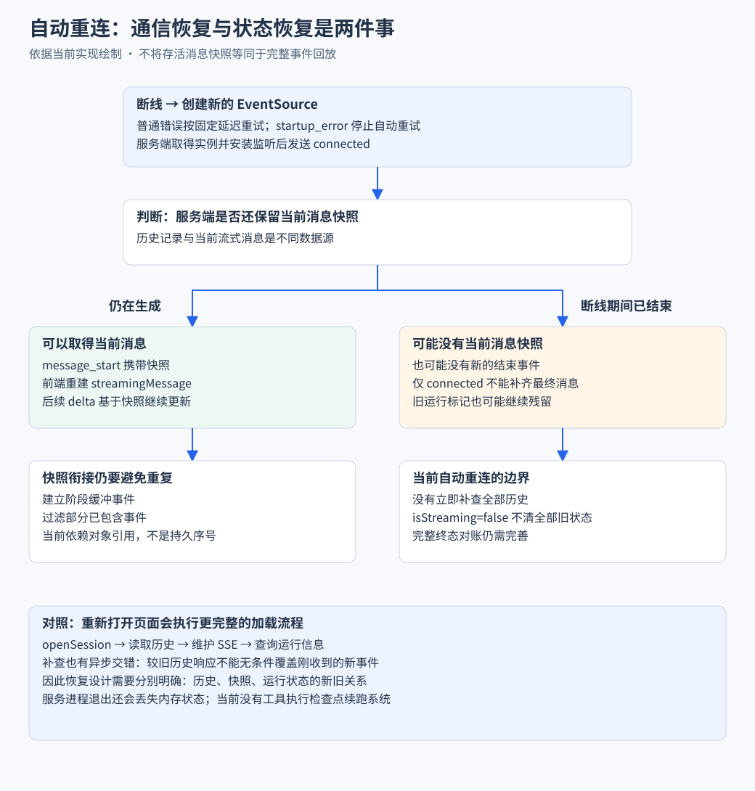

# 02 状态管理与会话恢复

> 对应简历：**「针对文本、思考和工具调用事件分段到达场景，基于纯函数 reducer 按内容索引组装消息块，并通过 toolCallId 关联工具调用与执行结果，实现流式内容和工具运行状态的分层展示」**；**「针对页面刷新后流式消息状态丢失的问题，结合会话历史查询、当前助手消息快照及 SSE 重连恢复界面；通过会话 ID、操作代次与查询序号校验异步结果，避免过期响应污染当前会话。对接 SDK 的手动及自动上下文压缩事件，展示压缩状态、当前上下文占用和会话 Token 用量。」**
>
> 优先级：**P0** 必答，**P1** 常见追问，**P2** 加分项。
>
> 源码链接固定到 commit [`27d6bee`](https://github.com/saohuahua/pi-web-vue/tree/27d6bee5878878aedf9a296b5e5e43236b56c22e)。SDK 为 `@earendil-works/pi-coding-agent@0.85.1`。

---

## Q12 为什么要用纯函数 reducer 管理流式消息？【P0】

**结论**：因为一条助手消息不是字符串，是**有序的块文档**。Agent 一轮回复里文本、思考、工具调用交替出现，顺序就是真实发生顺序。

**不用 reducer 会出的具体问题**

**① 结构会丢**。考虑这个结构：

```text
[0] text      "我先看看"              ← 已定稿
[1] toolCall  ls
[2] text      "目录结构是这样的"       ← 这段的第一个增量到达时
```

在 `[2]` 的第一个增量到达时，`content` 里**还没有** `[2]` 这个块。如果代码去「找最后一个 text 块」，会命中 `[0]`——**文本被追加到了第一段后面**。`contentIndex` 存在的理由就是让事件明确说「我属于第几块」。

**② 无法测试**。reducer 是纯函数，测试只需要构造 state 和事件：

```ts
// tests/shared/lib/streaming-message.test.ts
let state = streamReducer(INITIAL_STREAMING_STATE, { type: "start" })
state = streamReducer(state, { type: "snapshot", message: snapshot })
state = streamReducer(state, { type: "delta", event: { type: "text_start", contentIndex: 0 } })
state = streamReducer(state, { type: "delta", event: { type: "text_delta", contentIndex: 0, delta: "你" } })
expect(state.streamingMessage?.content).toEqual([{ type: "text", text: "你" }])
```

如果逻辑写在 `onmessage` 里，测试就要构造或 mock `EventSource`、模拟网络到达、等异步回调。

**③ 更新点散落**。所有流式状态变更收敛到一个入口：

```ts
// app/stores/chat.ts
function applyStream(action) {
  Object.assign(stream, streamReducer(stream, action))
}
```

`applyStream` 在全文件只有 **7 个调用点**，grep 一个函数名就能穷举。

**reducer 与 Pinia 的分工**

| | `streamReducer`（纯函数） | Pinia store |
| --- | --- | --- |
| 位置 | `shared/lib/` | `app/stores/` |
| 职责 | **怎么算**（给定事件算出新状态） | **什么时候算、算完放哪** |
| 可测试性 | 直接调用 | 需要建 Pinia 实例、mock fetch |

**store 决定「要不要处理」，reducer 决定「处理成什么样」**：

```ts
case "message_start": {
  // 迟到事件守卫 run 已结束的流式事件会复活幽灵气泡
  if (!isRunning.value) break                      // ← store 的决策
  if (msg?.role === "assistant") {
    applyStream({ type: "snapshot", message: msg }) // ← 交给 reducer
  }
  break
}
```

**归属说明**：`shared/lib/streaming-message.ts` 是从 pi-web **原样移植**的（见 `THIRD_PARTY_NOTICES.md`）。本项目做的是把它接进 Pinia 状态、加迟到事件守卫、以及配套测试。

**源码位置**：`shared/lib/streaming-message.ts`、`app/stores/chat.ts` `applyEvent`

**口述版（约 55 秒）**

> 因为一条助手消息不是一个字符串，而是一份有序的块文档。
>
> Agent 的一轮回复结构是「先思考、然后调工具、拿到结果再输出文本」，这些内容块交替出现，顺序就是真实发生的顺序。拼字符串就没法把工具调用渲染成可折叠卡片，也没法在卡片里展示参数和结果。
>
> 所以我把消息表示成 `content` 块数组，流式事件里带一个 `contentIndex` 告诉我这个增量属于第几块。用索引而不是「找最后一个块」是有具体原因的：一轮里可能有多个同类型块，如果代码去找最后一个 text 块，第二段文本的第一个增量到达时那个块还没建出来，就会被错误地追加到第一段后面。
>
> 组装逻辑是纯函数 reducer，放在 `shared/lib` 里，不依赖 Vue 也不依赖 SDK。好处是能直接写单元测试，输入 state 和事件断言输出，不用 mock 网络；另外所有流式状态变更收敛到一个入口，全文件只有 7 个调用点。
>
> reducer 和 Pinia 不是二选一。reducer 负责「给定事件算出新状态」，Pinia 负责「什么时候处理、处理完还要做什么」。比如 `message_start` 来了，store 先判断当前是不是还在运行中——如果 run 已经结束，这个事件是迟到的，处理它会让已经消失的流式气泡复活，所以直接跳过。
>
> 这个 reducer 是从 pi-web 原样移植的，我做的是把它接进 Pinia、加迟到事件守卫，以及补测试。

**追问**

```text
Q: reducer 为什么放在 shared 而不是 app？
A: 它是纯函数，没有 Vue 依赖。放 shared 让它天然可测，
   也避免 app/ 目录下测试要 mock Vue 环境。
   shared 层还有个约束：不能 import pi 包，否则进不了浏览器产物。

Q: 每次 delta 都创建新对象，性能有问题吗？
A: 有 GC 压力，但当前没有实测数据。要优化可以考虑结构共享
   或按帧合并，但不可变更新的可推演性是当前测试的基础。
```

---

## Q13 reducer 怎么按内容索引组装？边界在哪？【P0】

**结论**：核心是 `updateContentBlock`，它把「定位块 → 计算新块 → 返回新状态」抽象出来。但**它只检查索引下界，不检查上界**——这是当前实现的真实边界。

```ts
// shared/lib/streaming-message.ts
function updateContentBlock(state, contentIndex, update) {
  const message = state.streamingMessage
  if (!message || !Number.isInteger(contentIndex) || contentIndex < 0) return state

  const content = [...message.content]
  const nextBlock = update(content[contentIndex])   // 越界时 current 是 undefined
  if (!nextBlock) return state
  content[contentIndex] = nextBlock                 // ← 越界时会写出稀疏数组
  return { isStreaming: true, streamingMessage: { ...message, content } }
}
```

**三类分支对索引的要求不一样**

| 分支类型 | 事件 | 越界时的行为 |
| --- | --- | --- |
| **增量型** | `text_delta`、`thinking_delta`、`toolcall_delta` | 要求当前块类型匹配。越界时 `current` 是 `undefined`，类型不匹配 → 返回 `null` → **放弃更新，安全** |
| **幂等型** | `text_start`、`thinking_start`、`toolcall_start` | 当前块不是目标类型就**新建块**。越界时会新建 → **可能写出稀疏数组** |
| **权威型** | `text_end`、`thinking_end`、`toolcall_end` | **不检查 `current`**，直接构造新块 → **可能写出稀疏数组** |

**所以「所有分支越界都返回 null」是错的**。只有 `_delta` 分支有这个保护，因为它们的实现是 `current?.type === "text" ? ... : null`——`undefined` 走 `null` 分支。

而 `_end` 分支长这样：

```ts
case "text_end":
  return updateContentBlock(state, event.contentIndex, (current) => ({
    ...(current?.type === "text" ? current : {}),   // ← current 是 undefined 也继续
    type: "text",
    text: event.content,
  }))                                                // ← 总是返回一个真值对象
```

`current` 是 `undefined` 时它照样返回 `{ type: "text", text: ... }`，于是 `content[contentIndex] = nextBlock` 会在数组末尾之外的位置赋值，**中间产生空洞**。例如 `content.length === 3` 而 `contentIndex === 5`，结果数组会变成 `[a, b, c, <empty>, <empty>, block]`。

`_start` 分支同理：`current?.type === "text" ? current : { type: "text", text: "" }`——越界时新建块，也会写出空洞。

**这意味着什么**

- 这是**当前实现的边界**，不是已修复的问题。源码里没有上界检查。
- 实际上会不会触发，取决于 SDK 会不会发出越界的 `contentIndex`。正常路径下 `contentIndex` 由 SDK 递增分配，不应该跳号。
- **没有测试覆盖这个场景**——`tests/shared/lib/streaming-message.test.ts` 只测了正常递增路径和快照归一化。

**如果被追问「怎么修」**

最小改动是在守卫里加上界判断，但要按事件类型区分语义：

- `_start` 的合法场景之一就是**在末尾新建块**（此时 `contentIndex === content.length`），所以上界应该是 `contentIndex <= content.length`
- `_end` 是对已有块的收尾，理论上应该要求 `contentIndex < content.length`

**九个分支的行为分类**

| 事件 | 行为 | 失败时 |
| --- | --- | --- |
| `text_start` / `thinking_start` / `toolcall_start` | 幂等：已有块保留，否则新建 | `toolcall_start` 无 `toolName` 时不建块 |
| `text_delta` / `thinking_delta` / `toolcall_delta` | 增量有损：要求类型匹配 | 不匹配返回 `null`，丢弃 |
| `text_end` / `thinking_end` / `toolcall_end` | 权威自愈：不关心当前块，直接覆盖 | — |

**最重要的规律**：**`_delta` 有损但安全，`_end` 权威但会越界写。**

`text_end` 的自愈能力是真实的：即使中间所有 delta 都丢了，只要它到了，块内容就是对的。但它同时也是越界风险的来源。

**完整推演：没有快照时所有事件都被丢弃**

```text
事件 1: text_start { contentIndex: 0 }
  state.streamingMessage === null → 守卫拦截，return state
事件 2: text_delta { contentIndex: 0, delta: "你好" }
  message === null → 同样被丢弃
事件 3: text_end { contentIndex: 0, content: "你好" }
  message === null → 还是被丢弃
```

**结论**：没有 `message_start` 快照，所有 delta 都被丢弃。这是正确的行为——`message_start` 才是「这一轮开始了」的信号。这个推演说明了服务端快照重放是**必要的**，不是可选优化。

**正常顺序的推演**

```text
① message_start → snapshot
   state = { isStreaming: true, streamingMessage: { role: "assistant", content: [] } }
② text_start { contentIndex: 0 }
   content = [] → update(undefined) → { type: "text", text: "" } → content[0]
③ text_delta { contentIndex: 0, delta: "你好" }
   current.type === "text" → { ...current, text: "" + "你好" }
④ text_end { contentIndex: 0, content: "你好，有什么可以帮你？" }
   → { ...current, type: "text", text: "..." }   ← 自愈
```

**工具调用的三阶段**

```text
toolcall_start → { type:"toolCall", toolCallId, toolName, input:{}, rawInput:"" }
toolcall_delta → rawInput 累积原始 JSON 片段（卡片显示「参数流入中」）
toolcall_end   → 整体替换为解析后的 input，rawInput 消失
```

`toolcall_start` 有两个防御：`event.id ?? current.toolCallId`（重发时保留已有 id）、`typeof event.toolName !== "string"` 时不建块（没有工具名没法渲染）。

**源码位置**：`shared/lib/streaming-message.ts`（移植自 pi-web）

**口述版（约 70 秒）**

> 核心是一个 `updateContentBlock` 函数，把「定位块、计算新块、返回新状态」抽象出来，九个事件分支只需要关心怎么算这一块。
>
> 它做四件事：浅拷贝 content 数组，把当前块交给调用方算新块，返回 null 就放弃更新，否则写回拷贝并返回新消息对象。用不可变更新是因为 reducer 是纯函数。
>
> 九个分支分三类。`_start` 幂等，块已存在就保留、否则新建。`_delta` 有损，要求当前块类型匹配，不匹配就返回 null 丢弃。`_end` 权威，不关心当前块是什么，直接用完整内容覆盖。
>
> 这个分类带来一个重要特性：delta 丢了不会导致最终结果错误。比如 `text_start` 丢了，后续 delta 都会被丢弃，表现是一段时间没内容然后整段突然出现；但 `text_end` 到了就会写对。
>
> 有一个推演能说明快照的必要性：如果没收到 `message_start`，`streamingMessage` 是 null，守卫会直接返回原状态——所有 delta 包括 `text_end` 都被丢弃。所以服务端补发快照不是可选优化。
>
> 这里我要主动说一个**实现边界**：`updateContentBlock` 只检查索引下界，不检查上界。`_delta` 分支因为有类型匹配检查，越界时会返回 null，是安全的；但 `_start` 和 `_end` 分支会新建块，越界时会写出稀疏数组。正常路径下 SDK 不会发跳号的 `contentIndex`，所以实际没触发过，而且没有测试覆盖这个场景。如果要修，需要按事件类型区分上界——`_start` 允许在末尾新建，`_end` 应该要求块已存在。

**追问**

```text
Q: 如果事件乱序呢？
A: 会错位。reducer 直接按下标写入，不校验连续性。
   当前依赖三层保证顺序：SDK 串行 emit、SSE 单流保序、
   缓冲按序补发。

Q: 如果事件重复呢？
A: 会重复。reducer 没有事件 ID 概念，
   重复的 text_delta 会导致文本重复。这是已知局限。

Q: 为什么 toolcall_start 没名字就不建块？
A: 块建出来也没法渲染，toolPreview 按 toolName 生成预览。
   宁可等下一个事件带名字。
```

---

## Q14 工具调用和工具结果怎么关联？【P0】

**结论**：唯一关联标识是 `toolCallId`。工具调用在助手消息的 `content` 里，结果是一条独立的 `toolResult` 消息。

```text
助手消息 content[]                      messages[]
┌────────────────────────┐            ┌──────────────────────────┐
│ { type: "toolCall",    │            │ { role: "toolResult",    │
│   toolCallId: "abc",   │◄──配对────►│   toolCallId: "abc",     │
│   toolName: "read" }   │            │   content: [...],        │
└────────────────────────┘            │   isError: false }       │
                                      └──────────────────────────┘
        ↓                                        ↓
   ToolCallCard :block                    toolResultsByCallId.get("abc")
```

**配对是派生值，不是独立状态**

```ts
// app/stores/chat.ts
const toolResultsByCallId = computed(() => {
  const map = new Map<string, ToolResultMessage>()
  for (const m of messages.value) {
    if (m.role === "toolResult") map.set(m.toolCallId, m)
  }
  return map
})
```

做成 computed 而不是独立 state，是为了保证单一事实来源——会话重载后 `messages` 变了，Map 自动重建。

**四种异常输入的实际行为**

| 异常 | 行为 | 后果 |
| --- | --- | --- |
| `toolCallId` 缺失 | `normalize.ts` 双字段兼容，都没有则给**空串** | 多个缺 ID 的工具**互相串** |
| `toolCallId` 重复 | `map.set` 后写覆盖先写 | 只保留最后一个结果 |
| 结果找不到调用 | 渲染成 `aria-hidden` 空 div | **孤儿结果不显示** |
| 调用找不到结果 | `toolResultsByCallId` 查不到 | 见下面的窗口 |

**为什么必须独立维护 `activeTools`**

助手消息在工具**开始执行之前**就定稿了。时序是：

```text
message_end（assistant 定稿）→ tool_execution_start → tool_execution_update
  → tool_execution_end → message_end（toolResult）
```

定稿后消息上的 `streaming` 已经是 false，光看消息判断不出工具还在跑。所以单独维护一个 `reactive(new Map())`，`tool_execution_start` 写入、`tool_execution_end` 删除、中间更新进度。

**一个状态错误窗口（静态推导）**

```ts
const isRunningTool = computed(
  () => !props.result && (props.streaming || chat.activeTools.has(props.block.toolCallId)),
)
```

| 情况 | `activeTools` 有 | `streaming` | 显示 |
| --- | --- | --- | --- |
| 工具正在执行 | ✅ | false | 「执行中」 |
| **执行完但结果没到** | ❌ | false | **「完成」**（错误） |
| 消息还在流式 | 任意 | true | 「执行中」 |

第二行是问题：`tool_execution_end` 到达时 `activeTools.delete(id)` 立即执行，但结果消息要等后续的 `message_end` 才进 `messages`。这个窗口里卡片会短暂显示「完成」且结果区为空。

> **静态推导，尚未实测**。窗口长度取决于两个事件之间的间隔，没有真实链路测试覆盖。

**参数显示的两阶段**

流式期间显示 `rawInput`（原始 JSON 片段），定稿后显示格式化 `input`。`normalize.ts` 为此分了两个导出——`normalizeStreamingToolCalls` 带 `rawInput`，`normalizeToolCalls` 不带。定稿路径走后者，把临时态丢掉。

**一个值得主动提的改进**

> 会话文件里如果存在「有 toolCall 但没有对应 toolResult」的助手消息，说明执行被中断了。前端可以把这类卡片标记为「未完成」而不是「完成」。**`toolResultsByCallId` 查不到就是未完成，不需要服务端改动。**

这个改进成本几乎为零，但能消除一个真实的误导——服务端重启后这种半截数据是必然会出现的（见 Q21）。

**源码位置**：`app/stores/chat.ts`、`app/components/ToolCallCard.vue`、`shared/lib/normalize.ts`（移植）

**口述版（约 60 秒）**

> 工具调用和工具结果只有一个关联标识：`toolCallId`。工具调用在助手消息的 content 数组里，执行结果是一条独立的 `toolResult` 消息。
>
> 我用一个 computed 从 `messages` 里扫出所有结果，建一个 `toolCallId` 到 result 的 Map。做成 computed 而不是独立 state，是为了保证只有一份事实来源——会话重载后 Map 自动重建。
>
> 「执行中」这个状态比较特殊。因为助手消息在工具**开始执行之前**就已经定稿了，定稿后消息上的 streaming 标记已经是 false，光看消息判断不出工具还在跑。所以我单独维护一个 `activeTools` 的 Map，start 时写入、end 时删除、中间更新进度。
>
> 异常输入有几个已知边界要诚实说。`toolCallId` 缺失时归一化会给空串，多个缺 ID 的工具会互相串。结果找不到对应调用时，它作为一条消息存在但渲染是一个 `aria-hidden` 的空 div，也就是不显示——用户看不到「有个结果没配上」。另外 `tool_execution_end` 到 `message_end` 之间有一个短窗口，卡片会短暂显示「完成」但结果区是空的，这是从代码路径推导的，没有实测过。
>
> 还有个我觉得值得改进的点：如果会话文件里有「有工具调用但没有对应结果」的消息，说明执行被中断了。当前实现会显示成「完成」，这是真实的误导。前端其实能检测出来——查不到结果就是未完成，不需要服务端改动。

**追问**

```text
Q: 两个工具同时执行会串吗？
A: 不会。activeTools 是 Map，可以同时存多条，
   状态条用 v-for 全部展示。块顺序由 contentIndex 保证。

Q: 工具执行失败怎么显示？
A: result.isError 为真时卡片加 is-error 类，状态「出错」。
   注意判定的是工具结果里的 isError，不是网络错误。

Q: rawInput 一直不消失？
A: 说明 toolcall_end 没到，可能流中断了。
   reload 后从会话文件读到的消息不带 rawInput。
```

---

## Q15 流式内容、工具状态为什么要分层展示？【P1】

**结论**：因为**生命周期和权威性都不同**。流式内容是临时的、可能丢的、没有 entryId；已定稿消息是持久的、权威的、有 entryId 的。

| 维度 | 流式内容 | 已定稿消息 |
| --- | --- | --- |
| 存储 | `stream.streamingMessage`（单对象） | `messages[]`（数组） |
| 权威性 | 增量拼出来的，可能有损 | 来自会话文件 |
| entryId | 没有 | 有（`entryIds[]` 平行数组） |
| 可编辑 | ❌ | ✅ |
| key | 无 key | `entryIds[i]` |

**三个理由**

1. **生命周期不同**——混在一个数组里要到处判断「这条是不是流式的」。
2. **key 策略不同**——已定稿用 `entryIds[i]`（服务端权威 ID）；流式气泡没有 key，因为它始终是最后一个节点。列表项有个回退 `entryIds[i] || local-${i}`：乐观追加的消息 entryId 是空串，reload 后填上真实值、key 变化导致重建，这是有意的。
3. **交接时机可控**——`message_end` 里「先追加进 messages 再清流式气泡」，顺序反了会闪一帧重复。

**第三层：运行状态条**

工具卡片显示的是**已完成消息里的工具调用**，运行状态条显示的是**此刻正在跑什么**。`chat.ts` 的注释说明了分工：

> 工具执行实时状态 卡片等 message_end 定稿后由历史渲染 状态条只负责此刻正在跑什么

还有「正在思考」占位，有五个否定条件——只在「等待模型首字」的真空期显示。

**思考块的分阶段展示**

流式期间显示「思考中… N 字」，定稿后显示「思考了 N 秒」。**时长不是计时器算的**，而是相邻两条消息的时间戳差。理由：reload 之后计时器就没了，但时间戳是从会话文件读出来的，永远能重算。

**分层的代价**：渲染两处、交接顺序敏感、「执行中」要同时看 `streaming` 和 `activeTools`、三层展示条件要互斥。

**源码位置**：`app/components/ChatPanel.vue`、`MessageItem.vue`、`ThinkingBlock.vue`

**口述版（约 50 秒）**

> 因为流式内容和已定稿消息的生命周期和权威性都不同，混在一起有三个问题。
>
> 一是 reload 时不知道该不该覆盖。已定稿消息来自会话文件、是权威的，reload 应该整体替换；流式消息是增量拼出来的，reload 不该碰它。
>
> 二是编辑功能无法判断。编辑历史消息需要 entryId 定位会话树节点，流式消息没有 entryId，所以列表项传 `editable`、流式气泡不传。
>
> 三是 key 策略不同。列表用 entryId 保证复用正确，流式气泡没有 key 因为它始终是最后一个节点。
>
> 除了这两层还有第三层：运行状态条。它显示「此刻正在跑什么」，而工具卡片显示的是「已完成消息里的工具调用」，这是不同时间维度的信息。
>
> 分层有个细节要注意：`message_end` 里必须先 push 到 messages 再清流式气泡，顺序反了会闪一帧重复或空白。
>
> 思考块的展示也分阶段：流式期间是「思考中 N 字」的实时计数，定稿后是「思考了 N 秒」。时长不是维护计时器，而是用相邻两条消息的时间戳差——因为 reload 后计时器就没了，但时间戳是从会话文件读出来的。

**追问**

```text
Q: 为什么流式气泡没有 key？
A: 它始终是列表最后一个节点，不需要复用判断。
   加 key 反而会在内容变化时触发不必要的重建。

Q: 「正在思考」占位为什么要五个否定条件？
A: 它只在等待模型首字的真空期显示。有流式内容、有工具在跑、
   在压缩、在重试，任何一种都有更具体的展示方式。
```

---

## Q16 刷新后恢复了什么？没恢复什么？【P0】

**结论**：三种数据来源补三样东西，**补的都是界面，不是任务**。而且「最终状态一定正确」这个说法**需要校准**——`reload` 失败时是静默的。



| 数据来源 | 补什么 | 权威性 |
| --- | --- | --- |
| 会话历史查询（HTTP） | 已落盘消息、entryId、分支树、累计统计 | 权威，但**有延迟** |
| 助手消息快照（SSE 握手包） | 未定稿的流式消息 | 权威，但是**瞬时的** |
| SSE 增量事件 | 订阅之后的变化 | 有损，断线期间永久丢失 |

**完整流程**

```text
① F5 → SPA 重载，内存状态清空
② Router 挂载 /session/[id]
③ chat.ts openSession(id)
   ├─ close()                        清空状态，generation +1
   ├─ draftStore.get(id) → draft     从 localStorage 恢复草稿
   └─ sessionLoading = true
④ chat.ts reload()
   ├─ sequence = ++reloadSequence
   ├─ GET /api/sessions/:id
   │    ↓ openSessionForRead：有存活 wrapper 用内存态，否则读磁盘
   │    ↓ buildSessionContext：沿 parentId 从 leaf 上溯到根
   ├─ 三重校验
   └─ messages / entryIds / tree / stats 赋值
⑤ connection.maintain(id)   建立 SSE
⑥ event-stream.ts const snapshot = session.streamingMessage
⑦ encode({ type: "connected", isStreaming })
⑧ chat.ts case "connected"
   ├─ isStreaming === true → isRunning = true, refreshRuntimeState()
   └─ isStreaming === false && sdkAgentActive → 合成 agent_settled
⑨ if (snapshot) encode({ type: "message_start", message: snapshot })
⑩ applyStream({ type: "snapshot", message })
⑪ 流式气泡显示完整内容，后续 delta 继续追加
```

**「界面恢复」与「任务恢复」的区别**

| | 界面（消息列表） | 任务（Agent 执行） |
| --- | --- | --- |
| 存储位置 | 会话文件（JSONL，持久化） | 服务端进程内存 |
| 能否重建 | ✅ 读文件就能重建 | ❌ 内存丢了就没了 |
| 刷新页面后 | 完全恢复 | **仍在跑**（进程没重启） |
| 服务端重启后 | 完全恢复 | **永久丢失** |

`/api/agent/running` 查的是**服务端进程内存**，进程重启后返回空数组，界面无从得知「原来有个任务被中断了」。

**「reload 兜底」这个说法要校准**

我原来写「最终状态一定正确，因为每次 `agent_settled` 之后都会 reload 对账」。这句话**不完全成立**，因为 `reload` 自己会失败：

```ts
// chat.ts
const body = await fetchSessionDetail(id).catch(() => null)
if (!body) return null;        // ← 静默失败，没有重试、没有提示
```

三种情况下 `reload` 不会完成对账：

1. **网络请求失败**——被 `catch` 成 `null`，直接 `return`
2. **三重校验失败**——会话已切换或有更新的 reload，返回 `null`（这个是正确的行为）
3. **服务端 500**——`fetchSessionDetail` 抛错，同样被吞掉

所以准确的表述是：

> **对账机制存在，但它的成功依赖网络和会话状态。失败时是静默的**——界面会停留在上一次的权威数据，用户不知道数据可能已经过期。这是一个真实的可靠性缺口。

**正确性分级**

| 结论 | 依据 |
| --- | --- |
| 快照重放能让流式气泡不丢 | **源码确认**——reducer 守卫要求 `streamingMessage` 先存在 |
| `reload` 是权威数据来源 | **源码确认** |
| 「reload 之后最终状态一定正确」 | ❌ **不成立**——`reload` 可能静默失败 |
| 断线期间事件永久丢失 | **源码确认**——无序号、无游标、无缓冲 |
| 快照去重的引用相等前提 | **待核实**——单测用手工对象，真实链路未验证 |
| `isStreaming === false` 等于会话完全空闲 | ❌ **不成立**——`isStreaming` 只反映 `_isAgentRunActive`，不含压缩 |

**局限**

| 局限 | 根因 |
| --- | --- |
| 断线期间事件永久丢失 | 无事件序号、无游标、无服务端缓冲 |
| 无法判断任务是否被中断 | 无任务状态持久化 |
| `reload` 全量拉取 | 无分页/增量协议 |
| **`reload` 失败静默** | `catch` 成 `null`，无提示无重试 |

**源码位置**：`app/stores/chat.ts` `reload` / `openSession` / `connected` 分支

**口述版（约 75 秒）**

> 先区分两个概念：**界面恢复**和**任务恢复**，这两个不是一回事。
>
> 刷新页面时我用三种数据拼界面。第一种是 HTTP 查会话历史，从会话文件读出已落盘的消息、entryId、分支树和累计统计。第二种是 SSE 握手包里的消息快照——如果刷新时 Agent 正在流式输出，服务端会补发一条 `message_start` 带当前消息的完整内容。这个快照不是优化而是必要的，因为 reducer 的守卫要求流式消息先存在，没有它所有增量都会被丢弃，用户看到的是空的流式气泡。第三种是握手之后的增量事件。
>
> 但这三种补的都是**界面**。任务本身一直跑在服务端进程里，浏览器只是重新订阅。如果服务端进程重启，那个任务就真的没了——前端连「曾经有个任务被中断了」都不知道，这个信息没有持久化。
>
> 这里我要修正一个我自己之前的说法。我原来写「最终状态一定正确，因为每次落定都会 reload 对账」。这句话不完全成立，因为 `reload` 自己会失败——请求失败会被 catch 成 null 然后直接返回，既没有重试也没有提示。所以准确的说法是：**对账机制存在，但它的成功依赖网络和会话状态，失败时是静默的**，界面会停留在上一次的数据，用户不知道可能已经过期。这是一个真实的可靠性缺口。
>
> 还有个补偿逻辑值得一提：如果断线期间任务正好结束了，那个 `agent_settled` 是在没有连接时发的，永久丢了。所以我在处理 `connected` 时加了一层判断——如果握手包说服务端没在跑、但本地还认为 SDK 活跃，就主动合成一次落定。

**追问**

```text
Q: 断线期间的工具执行细节能恢复吗？
A: 不能。那些 tool_execution_* 事件永久丢了。
   但工具的执行结果在会话文件里，reload 之后能看到最终结果。

Q: 快照和增量会不会重复？
A: 有一个去重函数用引用相等。单元测试用手工构造的同一对象
   验证过逻辑，但真实链路上 SDK 是否复用同一对象引用，
   我没有验证。这是明确的待确认项。

Q: openSession 的顺序为什么这么安排？
A: 三个顺序都有理由。先 close 是因为不关旧连接的话旧事件
   还会流进新会话视图。先恢复草稿再 await reload，是因为
   反过来用户在加载期间打的字会被晚到结果覆盖。
   最后才建连，是先有数据再有连接。
```

---

## Q17 会话 ID 不够用吗？为什么要加代次和序号？【P0】

**结论**：三层判据各防一类不同的竞态，不是冗余。用**场景 → 问题 → 原因 → 方案 → 边界**来看：

**场景**：用户在会话 A 发起历史查询，马上切到 B，此时 A 的响应才回来。

**问题**：B 的消息列表、模型名、上下文用量被 A 的数据覆盖。

**原因**：异步操作完成时，当前页面的归属已经变化了。

**方案**：在写入点校验三层身份。

| 层 | 防什么 | 为什么前一层不够 |
| --- | --- | --- |
| `sessionId` | 已切到别的会话 | — |
| `sessionGeneration` | A→B→A 之后旧响应回来 | A→B→A 后 sessionId 又匹配了，但响应反映的是几轮之前的状态 |
| `reloadSequence` | 同会话内两次 reload 乱序返回 | 两次的 sessionId 和代次都相同，但旧的可能后返回 |

**第二层的具体场景**：

```text
t0  打开 A          sessionId = A, generation = 0
t1  发起 reload(A)  sequence = 1
t2  切到 B          close() → generation = 1
t4  切回 A          close() → generation = 2
t6  t1 的响应回来    sessionId.value === A ✅ 通过第一层
                    但 generation 是 0 ≠ 2 → 拒绝 ✅
```

**第三层的具体场景**：

```text
t0  agent_end 到达      → reload()  sequence = 1
t1  agent_settled 到达  → reload()  sequence = 2
t2  t1 的响应先回来      sequence 匹配 → 写入 ✅
t3  t0 的响应后回来      sequence 不匹配 → 拒绝 ✅
```

**最严格的一处校验**（`reload` 里用满三层）：

```ts
if (sessionId.value !== id || generation !== sessionGeneration || sequence !== reloadSequence)
  return null
```

**校验点分布**

| 文件 | 处数 |
| --- | --- |
| `app/stores/chat.ts` | 13 处 |
| `app/composables/useSessionNavigation.ts` | 8 处 |
| `app/composables/useSessionRuntime.ts` | 8 处 |
| `app/composables/usePromptQueue.ts` | 4 处 |

**为什么这么多**：每个 `await` 之后都要重新确认——`await` 期间用户可能切会话了。

**取舍：为什么不用 AbortController**

| 方式 | 问题 |
| --- | --- |
| 取消请求 | 需要每个请求传 signal；而且**取消请求不等于阻止回调执行**——已缓冲的数据仍可能触发回调 |
| **写入点校验**（当前） | 简单可靠，不改请求层 |
| 每会话独立 store | 内存开销大，跨会话共享的数据不好处理 |

**边界**：校验靠人工维护，每个新增的 `await` 后都要记得加。已知一处缺口——`openSession` 里 `syncFromSessionCwd` 缺 sessionId 守卫（**静态推导，未实测**）。影响范围限于工作区选择器显示。

**源码位置**：`app/stores/chat.ts`、`app/composables/`

**口述版（约 65 秒）**

> 这三层是逐步加出来的，每层防一类不同的竞态。
>
> 场景是：用户在会话 A 发起历史查询，马上切到 B，A 的响应才回来。如果不处理，B 的界面会被 A 的数据覆盖。原因很简单——异步操作完成时，当前页面的归属已经变了。
>
> 第一层是会话 ID，防「响应回来时已经切到别的会话了」。最直观，但只靠它不够。
>
> 第二层是操作代次。场景是用户从 A 切到 B 再切回 A，这时候会话 ID 又是 A 了，第一层会通过。但那个响应是第一次打开 A 时发的，中间 A 已经被关闭过，可能已经有新消息了。所以我在每次 `close()` 时递增一个代次，请求发出前记下，响应回来时比对。
>
> 第三层是查询序号。同一个会话里连续触发两次 reload 很常见——`agent_end` 和 `agent_settled` 挨得很近。这两次的会话 ID 和代次都相同，但第一次的响应可能因为网络抖动晚于第二次返回，携带更旧的数据。所以每次 reload 开头递增序号，回来时比对。
>
> 整个 store 里有 13 处校验点，原则是每个 await 之后都要重新确认。
>
> 有个设计选择值得说：我没用 `AbortController` 取消请求，而是选择在写入点校验。因为取消请求和阻止过期结果生效是两件事——取消能省带宽，但不能保证回调不执行，已缓冲的数据仍可能触发回调。在写入点校验是更可靠的防线。
>
> 我也知道一个缺口：`openSession` 里同步工作区 cwd 那一行没有加会话 ID 守卫，而同一个 try 块里上面那行有。这是从代码推导的，没实测过，影响范围限于工作区选择器的显示。

**追问**

```text
Q: close() 里为什么同时递增两个计数器？
A: 代次让所有在途异步回调失效，序号让在途 reload 结果作废。
   粒度不同：代次是会话级的，序号是请求级的。

Q: 如果旧结果真的污染了状态，怎么排查？
A: 先确认污染的是哪个字段，再搜这个字段的所有赋值点，
   检查每个赋值点上游有没有校验。重点看跨 await 的写入。
```

---

## Q18 队列状态为什么需要版本号？【P1】

**结论**：因为**写入源数量不同**。队列状态有两个写入源（SSE 推送 + HTTP 拉取），拉取结果可能过期；`contextUsage` 只有一个写入源。

**问题场景**

```text
t0  前端发 get_state 请求                      version = 5
t1  SSE 推来 queue_update（队列变成 3 条）      version = 6
t2  t0 的响应回来，携带「队列 2 条」（过期数据）
    直接覆盖 → 队列从 3 条变回 2 条  ❌ 数据倒退
```

**方案**：请求发出前记版本号，返回时版本一致才写入。

```ts
let version = 0
const applyUpdate = (messages) => { version += 1; queuedMessages.value = ... }
const applySnapshot = (messages, requestedAtVersion) => {
  if (requestedAtVersion === version) applyUpdate(messages)
}
```

**为什么两个字段策略不同**

| | `contextUsage` | `queuedMessages` |
| --- | --- | --- |
| 写入源 | **1 个**（HTTP 快照） | **2 个**（SSE + HTTP） |
| 冲突可能 | 无 | 有 |
| 处理 | 无条件覆盖 | 版本守卫 |

`contextUsage` 可以无条件覆盖，因为 SSE 事件流里不带 context 数据，不存在第二个写入源；而它的值本身就是服务端每次现算的。

**版本守卫的复用**：`clear_queue` 请求飞行期间 SDK 可能又推来 `queue_update`，撤回响应返回的空队列就是过期的，所以 `recallQueue` 复用同一个守卫。

**这个模式的通用性**：「拉取 + 推送」双源状态的经典解法就是版本号加条件写入，和数据库乐观锁同一个思路。

**源码位置**：`app/composables/usePromptQueue.ts`、`useSessionRuntime.ts`

**口述版（约 45 秒）**

> 因为这两个字段的写入源数量不同。
>
> 队列状态有两个写入源：SSE 推来的 `queue_update` 事件，和 `get_state` 这个 HTTP 快照。推送是实时的，拉取是延迟的。如果快照在飞行期间 SSE 推来了新状态，快照返回时就是过期的，直接覆盖会让队列里的消息数量倒退。所以我在请求发出前记下版本号，返回时版本一致才写入。
>
> 同一个函数里 `contextUsage` 是直接覆盖的，因为它只有一个写入源，就是这条 HTTP 快照，SSE 事件流里不带上下文数据。而它的值本身就是服务端每次现算的，最新的就是最准的。
>
> 这个守卫不只用在快照上，撤回队列也复用了。因为 `clear_queue` 飞行期间 SDK 可能又推来 `queue_update`，这时候返回的空队列是过期的，直接覆盖会擦掉新的排队消息。

**追问**

```text
Q: 版本号为什么不用时间戳？
A: 时间戳有精度和时钟问题，同一毫秒内的两次更新无法区分。
   单调递增的计数器更可靠。

Q: model 和 thinkingLevel 为什么也不加守卫？
A: 它们的写入源比较少，当前没发现冲突。
   如果以后出现，可以复用同一套版本机制。
```

---

## Q19 上下文压缩是你实现的吗？【P0】

**结论**：**压缩算法是 SDK 的，我做的是接入和展示。**

| 能力 | 归属 |
| --- | --- |
| 手动压缩 `compact()` | **SDK** |
| 自动阈值压缩 `shouldCompact()` | **SDK** |
| 溢出恢复压缩 | **SDK** |
| 摘要生成算法 | **SDK** |
| `compaction_start` / `compaction_end` 事件 | **SDK** |
| 压缩入口按钮与状态展示 | **项目** |

**触发条件与默认值**

```js
// compaction.js
export function shouldCompact(contextTokens, contextWindow, settings) {
    if (!settings.enabled) return false;
    return contextTokens > contextWindow - settings.reserveTokens;
}
```

**注意：不是百分比阈值，是 token 差额。**

| 参数 | 默认值 | 可配置 |
| --- | --- | --- |
| `reserveTokens` | **16384** | ✅ `~/.pi/agent/settings.json` 或 `<project-dir>/.pi/settings.json` |
| `keepRecentTokens` | **20000** | ✅ 同上 |
| `enabled` | `true` | ✅ 同上 |

> **重要前提**：这些是 SDK `0.85.1` 的**默认值**（`docs/compaction.md:35,43`）。项目仓库里没有覆写，但**用户自己的 settings.json 可以覆盖**。所以「触发点约在 91.8%」这类推算只在默认配置下成立。

**默认配置下的触发点**（按 `contextWindow - 16384` 推算）：

| 模型窗口 | 触发点 |
| --- | --- |
| 200k | 约 91.8% |
| 32k | 约 48.8% |

前端显示的 80% 只是**展示用的警戒色**，和触发点没有对应关系。

**两种自动压缩原因**

| reason | 触发条件 | 是否重试被中断的轮 |
| --- | --- | --- |
| `"threshold"` | 超过阈值 | ❌ |
| `"overflow"` | 模型返回上下文超限错误且 `stopReason !== "stop"` | ✅ 重试一次 |
| `"overflow"` | 同上但 `stopReason === "stop"` | ❌ 响应已完成 |
| `"manual"` | 用户点按钮 | ❌ |

**压缩不删历史**

会话文件是 append-only 的（`session-manager.js:992` 文件契约明确「Entries cannot be modified or deleted」）。压缩只**追加**一条 `compaction` entry。「删除」发生在**投影层**——发给模型的上下文 = `[摘要] + [firstKeptEntryId 起保留的旧 entry] + [压缩之后的新 entry]`。

**项目侧做三件事**

1. 对接事件：`compaction_start` 时置 `isCompacting`，`compaction_end` 时清掉并 reload
2. 手动压缩入口：**成功路径不回滚 `isCompacting`**，因为 HTTP 返回只代表命令被接纳，压缩真正结束要等事件——这跟 Q5 的两个完成时点同一个思路
3. Token 展示（见 Q20）

**一个事实纠正**：当前 SDK 版本**只有** `compaction_start` / `compaction_end`，用 `reason` 区分类型。`auto_compaction_start` / `auto_compaction_end` 在 SDK 里**零匹配**，是移植时保留的兼容分支，**实际永不命中**。

**源码位置**：`app/composables/useSessionRuntime.ts` `compact`、`app/stores/chat.ts` 压缩事件分支

**口述版（约 60 秒）**

> 先说明边界：**压缩算法是 SDK 提供的，我做的是接入和展示**。
>
> SDK 有两条压缩路径。手动的是用户点按钮触发，它会先 abort 当前正在跑的 agent，而且压缩后不会继续那个被中断的对话轮。自动的分两种原因：一种是阈值触发，条件是当前上下文 token 数超过「窗口大小减去保留值」，默认保留 16384 个 token；另一种是溢出恢复，模型返回上下文超限错误后压缩并重试一次。
>
> 这里有个前提要说清楚：16384 和 20000 这两个是 SDK 的**默认值**，用户可以在 settings.json 里覆盖。所以「200k 窗口大约在 91.8% 触发」这个推算只在默认配置下成立。另外自动压缩的触发条件不是百分比，是 token 差额——前端显示的 80% 只是展示用的警戒色，和触发点没有对应关系。
>
> 项目侧我做三件事。一是对接压缩事件，`compaction_start` 时显示「压缩上下文中」，`compaction_end` 时清掉并 reload，因为压缩改变了消息链。二是手动压缩入口，这里有个细节：HTTP 返回只代表命令被接纳，压缩真正结束要等事件，所以成功路径我不回滚状态，只在失败时回滚——这跟 prompt 的接纳和完成是两个时点是一样的思路。
>
> 还有一点：压缩不会删历史。会话文件是 append-only 的，压缩只追加一条摘要 entry，被摘要的内容在文件里还在，只是发给模型时被投影层省略了。

**追问**

```text
Q: 压缩会不会丢历史？
A: 不会。会话文件 append-only，压缩只追加摘要 entry。
   被摘要的内容在文件里还在，只是发给模型时被省略。

Q: 压缩过程中能发新消息吗？
A: 不能。服务端 sendPrompt 有忙判定，
   导航中或压缩中直接返回 409。

Q: auto_compaction_start 这个分支为什么存在？
A: 从 pi-web 移植时保留的兼容分支，
   当前 SDK 没有这个事件名，永远不会命中。
```

---

## Q20 上下文占用和累计 Token 为什么不能相加？【P0】

**结论**：两个完全不同的指标。上下文占用是「此刻模型能看到多少」，压缩后会**下降**；累计 Token 是「整个会话烧了多少」，只增不减。

| | `contextUsage` | `stats.tokens` |
| --- | --- | --- |
| 含义 | **当前**上下文占用 | 整个会话**累计**消耗 |
| 数据来源 | SDK `getContextUsage()` | 项目自研 `computeSessionStats()` |
| 统计范围 | 活跃分支上的消息 | **整个会话文件**（含未激活分支 + 被压缩历史） |
| 压缩后 | **下降** | **不下降** |
| 精度 | 估算（字符数÷4） | 真实 usage 累加 |

代码注释把边界写死了：

> compaction 只追加摘要 entry 被汇总的历史仍留在文件里 因此累计值单调增长
> 与运行态的 context usage 是两项独立指标 **前端不得相加**

**`contextUsage` 的三种返回形态**

| 情形 | 返回 | 前端表现 |
| --- | --- | --- |
| 无模型或窗口为 0 | `undefined` | 不显示 |
| **刚压缩完，还没有新的 assistant 响应** | `{ tokens: null, percent: null }` | **显示问号图标** |
| 正常 | `{ tokens, contextWindow, percent }` | 显示剩余百分比 |

**情形 2 为什么返回 null**：压缩后的上一条 usage 反映的是**压缩前**的规模，用它显示会严重高估。前端对应降级——`percent === null` 时渲染问号图标而不是 0%。**null 和 0 的语义完全不同**。

**估算口径是两段式的**

| 分支 | tokens 来源 | 是否含 system prompt / 工具定义 |
| --- | --- | --- |
| 有有效 usage | 最后一条 assistant 的 provider usage | **隐式包含** |
| 无有效 usage | 逐条 `estimateTokens` 累加 | **不包含** |
| usage 之后的新消息 | `estimateTokens` 累加 | 不包含 |

`estimateTokens` 的口径是**字符数 ÷ 4**，SDK 自述：

> Estimate token count for a message using chars/4 heuristic. This is **conservative (overestimates tokens)**.

所以 `contextUsage` 是**估算值**，不是精确值。有 usage 时会锚定到真实值，之后新加的消息仍是估算。

**统计口径的准确描述**

项目**从未调用** SDK 的 `getSessionStats()`。它用自研的 `computeSessionStats(entries)` 从会话文件计算，且：

- 传的是**全量 `entries`** 而不是活跃分支——所以**切到另一个分支，累计 token 不会变**
- 只累加 `compaction` 的 usage，**没有处理 `branch_summary`**（SDK 的 `getSessionStats` 两者都累加）

**一处口径差异（要主动说）**：因为项目未启用分支摘要功能，实际不会有偏差。但文件头注释声称「与 SDK 的 `getSessionStats` 同一套口径」，**严格说是不准确的**——如果将来启用了分支摘要，统计会偏少。

**正确性分级**

| 结论 | 依据 |
| --- | --- |
| 两个指标口径不同、不能相加 | **源码确认**（注释 + 实现） |
| `contextUsage` 是估算值 | **源码确认**（SDK 注释自述 conservative） |
| 压缩后 `contextUsage` 下降 | **源码确认**——压缩边界后无有效 usage 时返回 null |
| 项目统计与 SDK 完全一致 | ❌ **不成立**——未处理 `branch_summary` |

**源码位置**：`shared/lib/session-stats.ts`（移植）、`app/components/ChatPanel.vue`

**口述版（约 65 秒）**

> 这是两个完全不同的指标，特别容易讲错。
>
> 一个是「当前上下文占用」，来自 SDK 的 `getContextUsage()`，表示**此刻模型能看到多少 token**。它的特点是压缩后会下降，因为压缩把旧消息换成摘要，模型能看到的内容变少了。
>
> 另一个是「会话累计 Token」，我从会话文件的所有 entry 累加出来，表示**整个会话一共烧了多少**。它只增不减，因为会话文件是 append-only 的，压缩只追加摘要 entry，被摘要的历史还在文件里。而且它统计的是整个文件，包括未激活的分支——所以切到另一个分支，累计值不会变。
>
> 代码注释里明确写了这两个是独立指标，前端不得相加。
>
> 有几个精度和边界要诚实说。第一，上下文占用是**估算值**，SDK 的口径是字符数除以 4，它自己注释说是偏保守的。只有在能拿到 provider 真实 usage 时才会锚定到准确值。
>
> 第二，刚压缩完的那一刻，SDK 会返回 `tokens: null`，因为压缩前的那条 usage 反映的是压缩前的规模，用它显示会严重高估。前端对应做了降级，显示问号而不是 0%——null 表示未知，0 表示确定是空的，语义完全不同。
>
> 第三，统计口径有一处偏差。我的 `computeSessionStats` 只累加 compaction 的 usage，而 SDK 的 `getSessionStats` 还累加 branch_summary。本项目没启用分支摘要，所以实际没影响，但严格说注释里「与 SDK 同一口径」不准确。另外项目其实从未调用 SDK 的 `getSessionStats()`，而是自己从会话文件复刻的。

**追问**

```text
Q: 为什么切到另一个分支累计 token 不变？
A: 因为 computeSessionStats 传的是全量 entries。
   注释明确写了「统计按完整 entries 累计 含未激活分支与被压缩历史」。
   这是有意的——累计统计应该反映真实计费。

Q: contextUsage 的 percent 会超过 100 吗？
A: SDK 侧不做裁剪，可能超过（估算偏保守）。
   前端 clamp 到 [0, 100]。

Q: 成本为什么显示「未提供」？
A: 不是所有模型都提供价格数据。
   formatCost 把「无价格数据」和「真实为 0」统一处理，不估算。
```

---

## Q21 任务执行中服务端重启会发生什么？【P1】

**结论**：**任务永久丢失，而且前端不知道它被中断了。**

| 状态 | 存储位置 | 重启后 |
| --- | --- | --- |
| 会话消息（entry 树） | 磁盘 JSONL | ✅ 保留 |
| 会话元数据 | 磁盘 JSONL | ✅ 保留 |
| **Agent 执行实例** | **进程内存**（`registry`） | ❌ 丢失 |
| **正在执行的工具** | **进程内存**（SDK 内部） | ❌ 丢失 |
| **运行中队列** | **进程内存**（SDK 内部） | ❌ 丢失 |

**为什么 Agent 执行不能跨进程恢复**

执行是一个「活的」过程，不是可序列化的状态：

1. **模型请求的流式响应**——可能接收了一半，连接断了就是断了
2. **正在执行的工具**——子进程可能随父进程一起死
3. **SDK 内部的执行状态机**——它知道自己在「第 3 轮、等工具结果」，但这个状态没持久化

**能恢复的只有「结果」，不能恢复的是「过程」**。

**关于外部子进程的一个精确表述**

服务端进程退出时，内存中的 SDK 状态一定丢失。但**外部 bash 子进程是否一定退出，取决于操作系统和实际启动方式**——如果子进程被 detach 或放入独立进程组，它可能继续存活。当前项目没有显式管理这一点，所以：

> **准确说法**：进程重启后 Agent 的执行上下文一定丢失，正在进行的工具调用无法从断点恢复。子进程的存活状态不确定，取决于它是否脱离了父进程组。这是**待核实项**，不是「一定退出」。

**单纯恢复历史消息为什么不够**

历史消息里没有「有一个任务被中断了」这个事实。重启后 `registry` 是空的 → `/api/agent/running` 返回空数组 → 侧栏显示「没有会话在跑」。

但如果中断发生在一次工具调用之后，会话文件里会留下「有 toolCall 但没有对应 toolResult」的半截数据。界面会怎么显示？`result` 是 undefined、`activeTools` 是空的、`streaming` 是 false → **显示「完成」**。

**这是一个真实的误导**：工具实际上没执行完，但界面显示「完成」。

**改进建议（按成本排序）**

**① 前端检测未完成的工具调用**（成本极低，纯前端）

会话文件里如果有「有 toolCall 但没有对应 toolResult」的助手消息，说明执行被中断。前端可以把这类卡片标记为「未完成」而不是「完成」。`toolResultsByCallId` 查不到就是未完成，**不需要服务端改动**。

**② 执行状态落盘**（成本中等）：记录 `{ sessionId, commandId, startedAt, status }`，启动时把 `running` 改成 `interrupted`。

**③ 命令幂等**（成本中等）：前端生成 `commandId`，服务端记录已处理的 ID。

**④ 完整方案**（成本很高）：持久化执行状态机让任务从断点继续——需要 SDK 支持序列化执行状态，**当前不提供**。

**多实例部署是同一个根因**：`registry` 是进程内 Map，多实例下同一会话会在两个进程各建一个实例，同时写同一个 JSONL。

**源码位置**：`server/utils/rpc-manager.ts` `registry`、`server/plugins/cleanup.ts`

**口述版（约 65 秒）**

> 任务会永久丢失，而且前端不知道它被中断了。
>
> 原因是执行状态全在进程内存里。会话消息存在磁盘的 JSONL 文件，重启后能读回来；但 Agent 执行实例、正在跑的工具、运行中的队列，全在进程内存，重启就没了。`registry` 是一个模块级 Map，进程一重启就是空的。
>
> 更深的问题是：**Agent 执行本身不能跨进程恢复**。它不是可以序列化的状态，而是一个活的进程——里面可能有正在接收的模型流式响应、正在跑的子进程、SDK 内部的执行状态机。能恢复的只有结果，不能恢复的是过程。
>
> 更糟的是单纯恢复历史消息不够。因为历史消息里没有「有一个任务被中断了」这个事实。重启后接口返回空数组，前端以为一切正常。但如果中断发生在一次工具调用之后，会话文件里会留下「有工具调用但没有对应结果」的半截数据，而界面会把这种情况显示成「完成」——这是真实的误导。
>
> 有一个点我要说得更精确：进程重启后执行上下文一定丢失，但**外部子进程是否一定退出我不确定**，取决于它有没有脱离父进程组。当前项目没有显式管理这个，所以这是待核实的。
>
> 改进我按成本排了优先级。第一件成本几乎为零、纯前端就能做：检测「有工具调用但没有结果」的情况，标记成「未完成」。前端已经有这个信息了——查结果 Map 查不到就是未完成。第二件是执行状态落盘，记录任务状态，启动时把 running 改成 interrupted。第三件是命令幂等。至于完整的任务恢复，需要 SDK 支持序列化执行状态，当前不提供，不在可行范围内。

**追问**

```text
Q: 优雅关闭时会发生什么？
A: nitro 的 close hook 会调 destroyAllRpcSessions，
   把 wrapper dispose 掉。但正在执行的 Agent 任务不会完成，
   它会随进程一起消失。

Q: 为什么不做任务队列持久化？
A: 因为执行体本身不能序列化。即使记下「有个任务待执行」，
   重启后也无法从断点继续——工具已经跑了半截，
   模型请求已经断了。

Q: SSE 断线和进程重启有什么区别？
A: 完全不同。SSE 断线只是传输层断了，服务端 Agent 还在跑，
   重连后能看到结果。进程重启是执行体没了。
```

---

## 本篇小结

| 决策 | 解决的问题 | 代价 |
| --- | --- | --- |
| 块数组 + `contentIndex` | 文本/思考/工具交替出现时能定位正确的块 | **`_start`/`_end` 分支缺上界检查，可能写出稀疏数组** |
| 纯函数 reducer | 可测试、状态变更收敛 | 无去重、无排序；移植自 pi-web |
| 三层判据 + 队列版本 | 四类异步竞态 | 33 处校验点靠人工维护 |
| 压缩对接而不实现 | 边界清晰 | 受 SDK 事件结构约束 |

**最关键的两个认知**：

1. **增量事件有损，权威事件自愈**——中间丢事件不会导致最终结果错误，但 `_end` 也是越界风险的来源。
2. **对账机制存在，但不保证成功**——`reload` 失败时静默返回，界面会停留在旧数据。

**需要主动划清的边界**：

1. **界面恢复 ≠ 任务恢复**——刷新恢复界面，服务端重启任务就没了
2. **压缩是 SDK 的**——项目只做事件对接和状态展示
3. **上下文占用 ≠ 累计 Token**——前者压缩后下降，后者只增不减
4. **项目统计未处理 `branch_summary`**——「与 SDK 同一口径」的说法不准确
5. **「有工具调用但没有结果」显示成「完成」**——真实误导点，纯前端可修
6. **`isStreaming === false` ≠ 会话完全空闲**——它不含压缩状态
